# Changelog

What's new in Wipebot, a raid assistant for World of Warcraft. Each change is tagged with where you'll notice it: `Agent` is the analysis itself, wherever you ask; `MCP` is Wipebot in Claude and ChatGPT; `Discord` is Wipebot in Discord.

The format is based on [Keep a Changelog](https://keepachangelog.com/en/1.1.0/). Wipebot runs from its main branch: changes since the last version are under Unreleased. Versions before 0.1.0, the first public release, are one a day.

## [Unreleased]

### Fixed

- `Agent` **A night two raiders logged counts once.** Two raiders logging the same night give two logs with every pull in both, and a player's deaths over the weeks counted each of those pulls and deaths twice ("54 pulls" on a night of 27). So did the times a tank took the boss with each spell. Each pull now counts once, from the first log that has it.

## [1.2.0] - 2026-11-11

### Added

- `MCP` **Claude and ChatGPT read Wipebot's method without the plugin.** How to read a wipe, a night or a player's log, and what an answer holds, used to reach only the Discord bot and people who had added the plugin: with the connector alone, Claude and ChatGPT got the tools and nothing on how to use them. They now read the method from a tool of its own before the first question. On the questions that went wrong without it, 19 of 33 answers were right where 11 were, against 22 with the plugin. An answer takes a few seconds longer.

### Fixed

- `MCP` **Claude opens Wipebot's views without asking first.** Since 1.1.0 Claude held every view back behind "This app wants to show content from other websites" until you allowed raidstrats.gg: the page all views share said it may show a raid plan from there. Only the raid plan's view says so now, so a pull, a player, a night or a meter opens as before, and Claude asks only when a plan is shown.
- `MCP` **A pull's card reads cleanly on a phone.** The boss box keeps each % with what it is ("best of this log: WCL 4.5%"), where a narrow card left "WCL 4.5%" on a line of its own like a second answer. A damage peak's number is no longer written over the spike beside it: it stands next to its own peak, or stays in the tooltip when there's no room.

  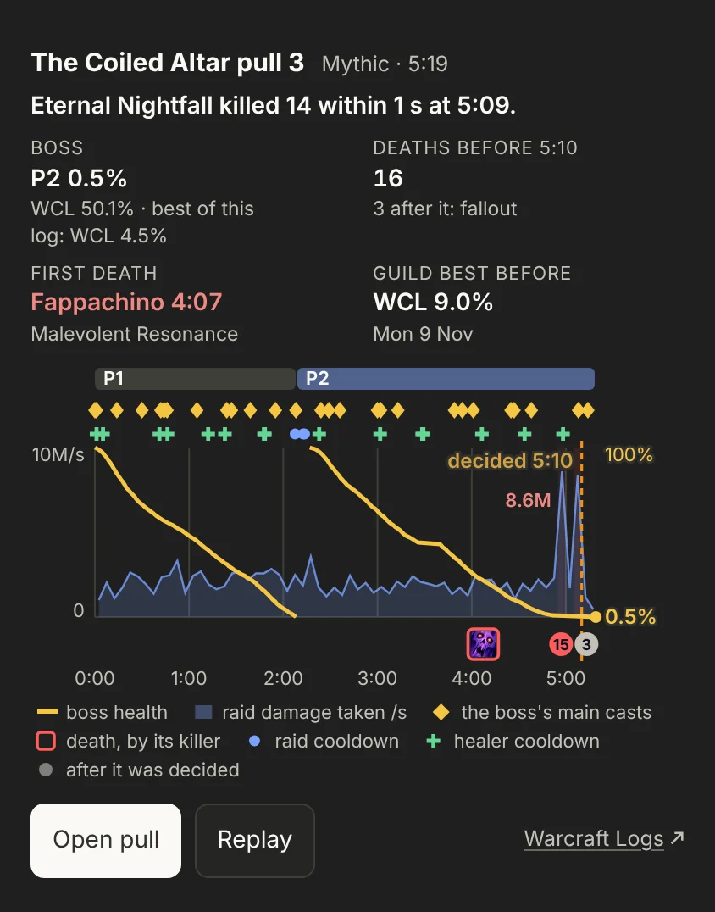
- `Agent` **Ascendance counts for a damage spike it was still up in.** A healing cooldown pressed more than 5 s before a spike counts for it while it lasts, and a Restoration Shaman's Ascendance had no duration to last by, so it never did: on a Twin Fangs kill the 1:58-2:05 spike listed no healing cooldown, with Ascendance pressed at 1:52 and up until 2:10, which reads as the healers leaving the spike uncovered. How long each press of Ascendance lasted is now read from its buff in the log: that spike lists "Ascendance (Enfo) at 1:52", and the shaman has 2 healing cooldowns in a spike where it said 1. A press whose buff ran out before half the spike still isn't counted for it.
- `Agent` **"Better than last week?" counts tonight too.** Night by night over the weeks, Wipebot lists the guild's raid nights as Warcraft Logs' attendance has them, and attendance can lack a log uploaded within the hour: the night you asked about was then left out, and the best wipe night by night stopped a night short. The night of the log you ask about is now listed even when attendance doesn't have it yet.

## [1.1.0] - 2026-11-11

### Added

- `MCP` **See a raid plan as raidstrats.gg draws it.** Asked for the plan as it is ("what's our plan for this boss?"), Wipebot shows each plan with the names saved on its spots: in ChatGPT the plan itself, its scenes a click apart and your own spots lit when you ask where you stand; in Claude a link that opens it.

  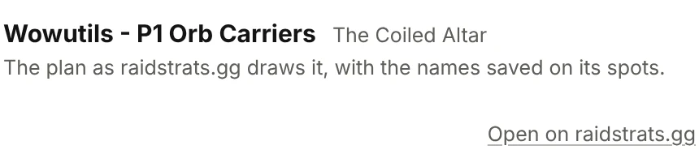
- `MCP` **The replay shows the phases, the boss's health and what it casts next.** The replay's timeline is coloured by phase, each named under it, and a phase the fight went back to keeps its colour. A frame at the top left gives the boss, the phase and its health as the pull plays, a new bar for each phase's boss as raiders count it ("P2 97.5%"). At the top right, "Coming up" counts down the boss's next casts in the log over the coming 20 s, those Lorrgs tracks in bold.

  
- `MCP` **Explore a raid night on Wipebot's website, under the demo's answers.** On [wipebot.enfo.dev](https://wipebot.enfo.dev/#try), below Wipebot's answers about a real Mythic night, the night is drawn with the same view Claude and ChatGPT show: each pull's boss health left, coloured by what ended it, and a click on a pull opens its deaths, cooldowns and replay. A view's "Ask" button puts its question in the demo's box. The demo's recorded answers were asked again with today's Wipebot, and show its own pictures.

  

### Changed

- `MCP` **A player's night sits in the chat on a phone.** In Claude the card no longer paints its own grey box over the chat, the pull numbers beside each cause of death are smaller chips (still a finger's tap), and their key sits above them where the scroll button can't cover it. The verdict reads "2 of those 8 deaths were survivable with a ready defensive or a healthstone", the box under it says "Astral Shift at both, a healthstone at 1" so the two never read as three deaths, and the headings are shorter ("Deaths that count", "Survivable", "What killed Enfo").

  

### Fixed

- `Discord` **Signing in turns raid notes and plans on at once.** On a bot many servers share, such as the public Wipebot, `/wipebot setup` kept saying "You aren't signed in yet" to an admin who had signed in with `/login private:True`: only the plain `/login` counted. Either sign-in counts now, and an admin who signs in in the server is told right away that notes and plans are on, without running `/wipebot setup` again. What it says while they're off is shorter, and when your characters aren't in the guild it names the Warcraft Logs account you signed in with.
- `Agent` **Damage spikes are measured second by second.** The raid's damage taken came from Warcraft Logs' graph, which averages a long pull over some 20 s at a time, so short bursts were flattened: a Twin Fangs kill had no spike and showed its three busiest stretches, its highest 5 s 1.53M/s, where the log's damage taken table gives 1.9M/s. Each second's damage is now worked back out of that graph, as the table gives it: that kill has five spikes, the one with the most damage 6:29-6:37 at 1.82M/s with no healing cooldown in it, and an Entombed Sentinels pull that had none shows three. A pull's four spikes with the most damage come in full and the others in a line with the healing cooldowns up in each ("4:49-4:54 (5 s) 1.85M/s: Ascendance (Enfo) at 4:53"). A pull with no spike at all shows its busiest 5 s, called so, in place of busiest stretches. The pull timeline's 5 s averages and the pull card's damage line and peaks read the same numbers, the table's: Sszorak pull 13's peak at 2:30 is 6.68M/s, where it read 5.73M/s, and a wipe's last burst stays in its last seconds instead of marking the 5 s before it.

  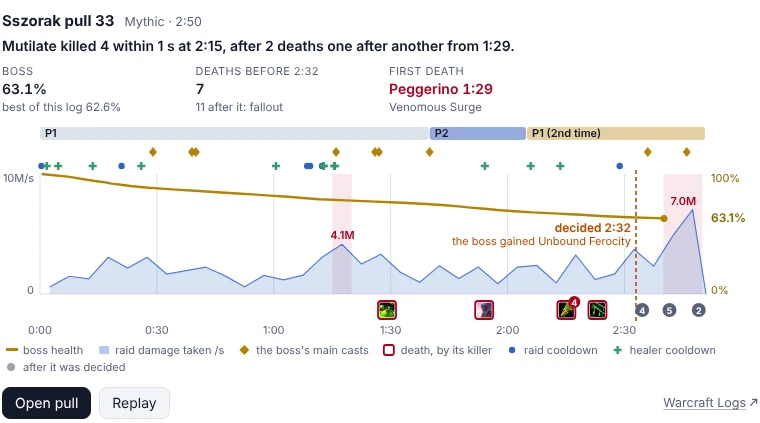
- `Agent` **Comparing with the top players no longer turns a defensive or a stat into a gap to close.** Against the top Restoration Shamans on a Vashnik kill, Earth Elemental's "3/5" sat among the cooldowns, and an answer told the player to cast it because most top players had. Defensive, tank and movement spells now have a line of their own, which says they answer a moment (a big hit, a death, movement), so how often the top players cast them isn't a fault. The top players' stats now also say that a gap from them is no reason to take a stat over one the guide ranks higher: a Farseer, whose guide puts Mastery first, was told to take Crit over it because the top players had more Crit.
- `Agent` **A timeline of one ability shows when the boss cast its main abilities.** Asked about the Malignant Totems' Malignance on a Vashnik wipe, the timeline listed every hit but not the boss's Imbibe that set the totems off, and the answer put that Imbibe at 1:51 instead of 1:48. It now ends with the boss's casts that Lorrgs tracks in the same window ("Imbibe 0:24, 1:48 · Malignant Catalyst 0:30, 0:35, 1:09, 1:14, 1:54"). For an ability the boss casts itself, it ends with the raid and healing cooldowns pressed around each cast (on the kill, "1:48: healing cooldowns Divine Hymn (Namsus) 1:39, Spirit Link Totem (Enfo) 1:46; raid cooldowns Rallying Cry (Nalaw) 1:46, Anti-Magic Zone (Nexsozz) 1:46, Darkness (Fappachino) 1:47"), so "did we have cooldowns for Imbibe?" is answered from what was pressed at each Imbibe, not only from where the damage spiked.

## [1.0.0] - 2026-11-11

### Added

- `Agent` **A trend by pull: is it getting better over the night?** Damage, healing, damage taken, casts and one ability's hits are now drawn pull by pull: a bar per pull, a kill capped in gold, and the median pull of each third of the night as a dashed line. A reset is hollow and left out, and the card's sentence states the thirds, as the answer now does from the same three medians ("The raid's healing per second: 1.67M in the first third of the 32 pulls, 1.65M in the middle and 1.87M in the last (each third's median pull)."). One player's trend is in their class colour, and in Discord the asker's row is drawn under the raid's. In Claude and ChatGPT a bar opens its pull, "Open trend" lists every pull's numbers, and a ranking over several pulls has "By pull".

  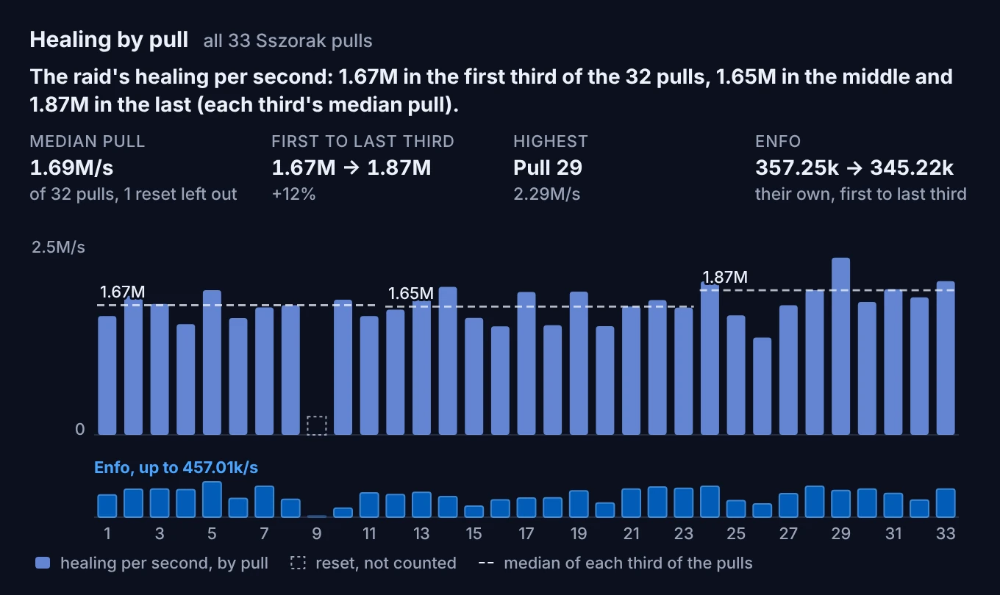
- `Agent` **Ask about one raider's part of the raid note.** "Did I do my part on that pull?" now gets that raider's own soaks, planned cooldowns, kicks and personals, on a pull or over the night, with the raid's counts beside them for scale. It used to come back with every player's rows to find one in. For the next raid it gives their jobs alone. A raid plan shown for one raider gives their spot or their row of the side panel, the plan's notes, who stands at the same place and who shares their circle. Cooldowns the note planned for after the wipe was already decided are now given as a count and the next three, where every one of them used to be listed. The picture that comes with a night's check, or with the note for the next raid, holds that raider's part as well: their kick assignment, their planned cooldowns and their row of each callout.

  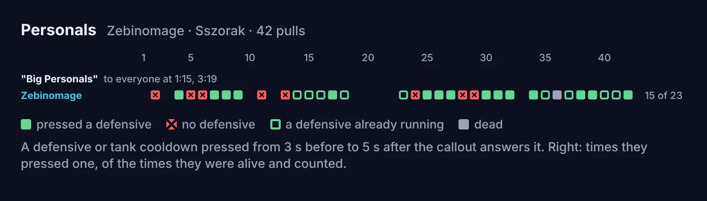
- `Agent` **Ask when an ability was cast and whom it hit, or what a player pressed.** "When was I hit by it, and for how much?" and "what did our druid press between 0:30 and 0:50?" now get an answer with each event to the millisecond. A pull's timeline narrows to one ability (its casts, its hits on players with their amounts, its debuff going on and off, the deaths it dealt) or to one player's casts and deaths, in your own log or a top player's. It names everyone a debuff reached its highest stack on in the same moment, where it named only the first in the log, and asked who kept a debuff to the end, the answer gives the span and each time's players ("2:36-3:01: ran out on 18: 2:36 ... · 3:01 ..."), where it had one row at the middle player's time. Other questions no ready-made analysis covers now come back with the time into the pull and every name, each fight as boss and pull number and each phase as P2 or I1. An answer too long to read is cut to its first rows and says how many were left out, where it used to be refused.
- `MCP` **Rankings are drawn in Claude and ChatGPT too.** "Who did the most damage?" and "who keeps getting hit by Tempest?" came with a meter in Discord and text alone in Claude and ChatGPT; both now get the card there. It opens with one sentence on who is first against the median ("Deathadim is first with 2.14 hits per minute of the pulls they were in, 2.5 times the median of the 22 players ranked."), then the top eight players' bars in their class colours, "Open ranking" for everyone's, and a mechanic's hits per player per pull. An answer that ranks several things opens one ranking and keeps the others to one line each. In Discord the meter's picture leads with the same sentence.

  
- `MCP` **A card says what you have open, and links to its log.** After a click on a pull or a replay stopped at 1:28, "why did this one go wrong?" now comes with a line saying what is on screen: "The user is now looking at Sszorak pull 13 (report KBYT4xXn7VNjDgh8)." It used to reach Claude or ChatGPT with nothing to say which pull or moment that was. Claude and ChatGPT read it with your next message where the app takes such a line. Every card also links to its pull, or to the night's report, on Warcraft Logs.

  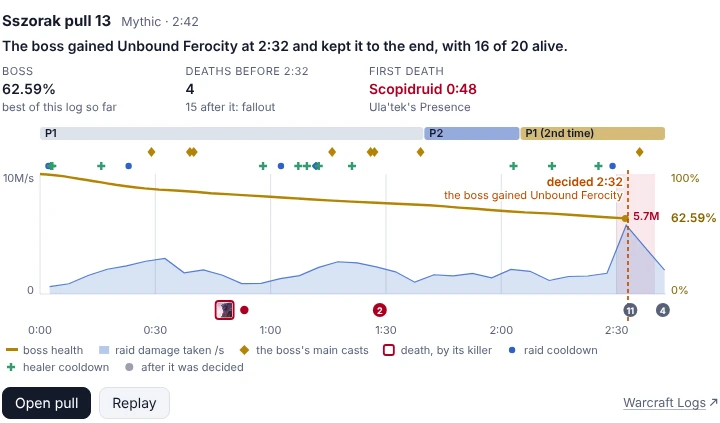

### Changed

- `Discord` **Admins: run `/login` and `/wipebot setup` once to keep raid notes and plans.** On a bot many servers share, such as the public Wipebot, they are now read and saved only once an admin has done it, also on a server set up before. The admin needs a character in the guild among those they claimed on Warcraft Logs. Until then, `/wipebot setup` says that notes and plans aren't read or saved, and answers about the logs and posts after wipes work meanwhile. A Wipebot of your own works as before.
- `Agent` **Every card leads with its verdict.** A card used to open on a row of numbers; it now opens with one sentence on how the pull ended, such as "The boss gained Unbound Ferocity at 2:32 and kept it to the end, with 16 of 20 alive". It can also say what would have kept someone alive, what ended the most pulls of a night or, asked night by night, which night got furthest, and Wipebot's code writes it from the same facts as the answer, so the two can't disagree. Under it come at most four numbers, one chart and two buttons, in Claude and ChatGPT and, without the buttons, in Discord's pictures. A player's card no longer gives a verdict the answer doesn't give: a rogue dead for 100 of a pull's 152 s was shown a green "Above the 90th percentile of ranked kills". It no longer lists what went well and what to fix, and leads with the death as the answer counts it ("Died at 0:53, before the wipe was decided at 2:32: dead for 100 of those 152 s (65%)."), or with their output and rank.

  

  
- `Agent` **A death's recap says first what did the damage, and whether they could have lived.** The killing blow is often a small tick after the hit that did it: the recap adds up the last 10 s by ability and names the biggest hit with the health it left. One death "to" a 50k tick was caused by a 378k hit two seconds before. Right after that, it says whether a ready defensive or a healthstone would have kept them alive, where that used to close the answer, and a defensive on cooldown says until when. On the death's card a save that was missed is now marked with a minus as something to do differently, as on the player's night, and no longer with the plus of what went well. A death that wasn't the player's to stop is no longer replayed as theirs: asked how a druid died, Wipebot named Barkskin as what would have kept them alive in a hit that killed four. The answer now says what the death was to the wipe (before it was decided, after it as fallout, or one of a hit killing many), the card leads with that for fallout or a hit killing many, and both replay only a death that was the player's own. A healthstone that would have saved them is said with "if they had one". A death with no killing blow shows on its card where the player was last logged: 113 yd from the raid after moving 63 yd in 3 s fits being thrown or knocked off.

  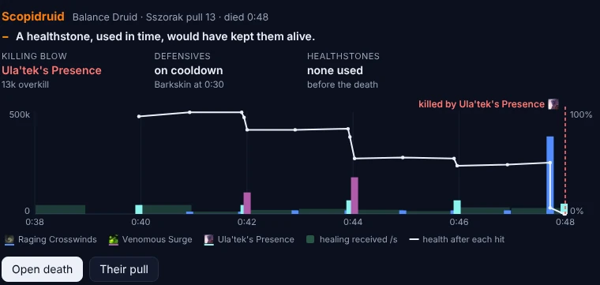

  
- `Discord` **Answers during a raid are short enough to read between pulls.** While your guild's report is being logged, an answer in Discord is the verdict and at most three one-sentence bullets, the fix first, with the rest as follow-up buttons. At other times a who, when or how many gets two bullets, a pull three, and a night, a player or a plan five. A bullet is its point in bold and one sentence with the one or two numbers behind it, 30 words at most. The warning sign marks only the one change to make. A follow-up you were already offered isn't offered again, and a greeting gets no buttons. Once Wipebot has read what it needed, the line under your question says "Writing the answer" where it said "Thinking".
- `Agent` **A first question about a pull comes back faster.** A first look at a player's pull now waits about 3.5 s less, and a comparison with top players about 7 s less, as Wipebot's requests to Warcraft Logs no longer queue at four a second. The guide sites are asked at the old pace. Wipebot also has less to read before it answers: a pull's summary is a sixth to a half shorter on the pulls measured and opens with how the pull ended. A night read pull by pull is one row a pull: about 40% shorter on a night of 33 pulls. A player's night says once what its rows mean: about a quarter shorter. That something isn't in the log is said once, and only when the answer turns on it.
- `Agent` **Who a mechanic hit most is ranked by the pulls each player was in.** Players are now ranked by hits per minute of the pulls they were in, so one who sat out half the night no longer ranks below someone hit as often per pull. The meter ranks them as the answer does, and each row says how many pulls that was. A death within 6 s of a hit is now called "a death within 6 s of a hit", whatever killed them, and no longer a death the mechanic "set up". A player's casts per minute over the pulls they were in now stand beside the night's rate, which for a healer in 12 of 33 pulls was a quarter of their real one.

  
- `Discord` **Wipebot's own messages are in Norwegian when your question is.** The answers already followed the question's language; now so do the line under your question, the steps, the buttons and menus, and what Wipebot says when it can't answer. A question too short to tell gets the server's language (`/wipebot setup language:`). Wipebot's Norwegian keeps the game's words as raiders write them ("pullet", "deaths", "adds"), and Norwegian answers keep more of them ("damage", "HP") and give a time in the fight as "på 3:13".
- `Agent` **One set of colours in every chart, made to be told apart.** How a night's pulls ended, the abilities in a death and the kinds of callout in a note share four colours that stay apart for red-green colour-blind readers, in the light theme and the dark. Past four is "other", drawn hollow. Gold, orange, red and green were tuned again to read as text, and a kick that went through or a cooldown not cast is a red square with a cross. Class colours now read on a light card, where a priest's white and a rogue's yellow all but vanished: a name keeps its class's colour at a lightness that reads, and a bar keeps the true colour with an edge.

  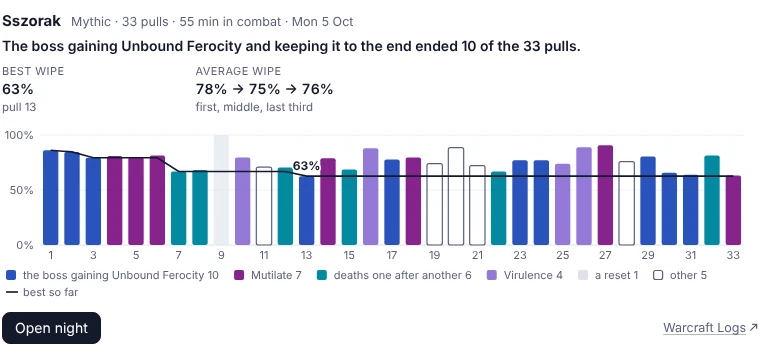

  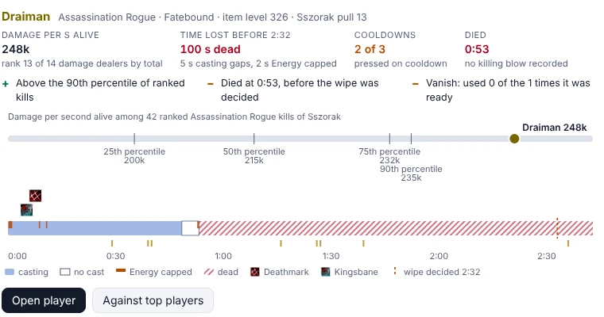
- `MCP` `Discord` **A night's card is half as tall, and a whole night leads with its bosses.** The card for a night's pulls is now its sentence, its numbers and the chart of the pulls, with the lists under "Open night". Asked about the whole night, it starts with every boss, its pulls and its kill or best wipe, no longer the last boss alone. A player's night is shorter the same way, and the night's card counts "10 of the 33 pulls", where it had "10 of 32" over a list of 33. While a card loads, grey blocks show where its parts will be, instead of a tall box with a spinner that jumped, and one that can't be read says why, with "Try again" where that helps. In Discord, when a picture's data couldn't be read, the answer now goes without it instead of with an empty card.

  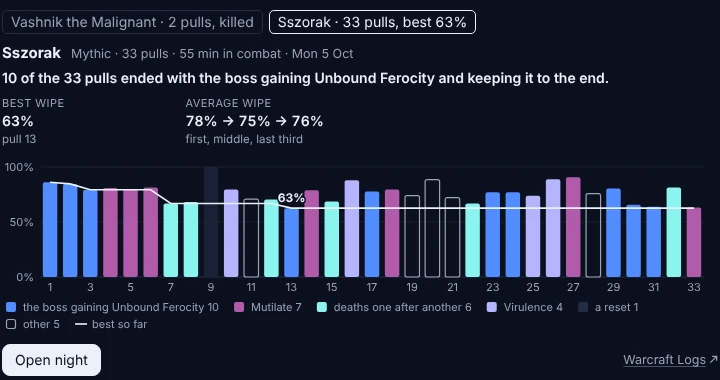

  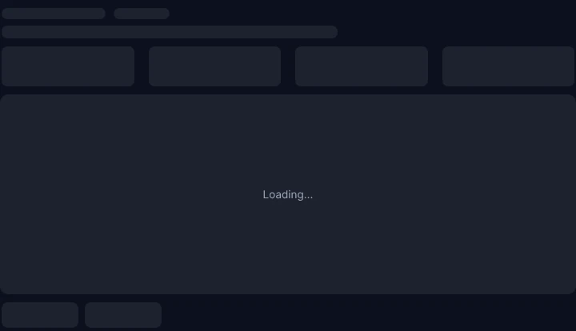
- `Agent` **Raid plans are saved by their link, and the raidstrats.gg login is gone.** An officer can now paste a raidstrats.gg plan's link instead of its export, and Wipebot puts the night's raiders on their spots with their full names, on a Wipebot set up with a raidstrats.gg key. In Viserio's assignment note, right-click the raidstrats.gg badge on a section's raid plan and Copy Link; Viserio's default plans are included. The login couldn't read those default plans, and a guild's own plan is still saved by its export. For those who run the bot: `wipebot raidstrats-login`, `RAIDSTRATS_CLIENT_ID` and `RAIDSTRATS_CLIENT_SECRET` are gone and the stored logins deleted; saved plans stay.

### Fixed

- `Agent` **How a pull ended reads one way, and right.** A pull that ended with the raid alive is no longer "called off": Wipebot names the boss's cast that landed on most of the living as it ended, where none had at any earlier moment or pull, or else says how many were alive and that no death decided it. A hit that kills many counts whole: "Viscous Cyst killed 5" on a pull where it killed 10 is gone, the wipe is decided at the hit's last death, and two abilities killing at once are both named. Every answer and the wipe post read one result, such as "deaths leading into Mutilate killing many". A wipe's summary no longer says the pull got past the enrage that ended most earlier pulls where the boss gained it on this pull too, after the wipe was decided: it says it came on this pull too, and when. A buff the boss carried through earlier wipes is no longer taken for the enrage that decided one, and a night counts apart the pulls on which the boss kept a buff: how many it ended, how many something else ended first, and how many it came too late on.
- `Agent` **A reset no longer counts as a death, and a battle res counts once it is taken.** A player's night said "died on 8 of 33 pulls" above a trend that added up to 7: a reset's row stays, marked, and the counts leave it out and say so: "32 pulls (1 reset left out)". That goes for the deaths that count, the time dead, cooldown sums, the night's defensives (twelve deaths on a reset had counted as defensives unused) and who a mechanic hit. A res counts once the player dies again or casts, so alive counts are no longer one too many. The night's killer splits its deaths ("57 deaths, 40 of them in hits killing many") and names players only for the rest.
- `Agent` **Raid notes are checked more carefully for cooldowns, personals and kicks.** A planned cooldown pressed under 3 s from its time in the note is now on time, where only under a second was: over four nights, 30% of presses were within a second and 64% within three. A raider who pressed a long defensive just before a "Big Personals" callout no longer reads as having pressed none: one still running counts, by the duration Lorrgs gives it, and the picture draws it as a green outline. A shaman's Reincarnation is no longer an answer, and "Ready" lists only the defensives the raider cast that night. A planned cooldown not cast says when it was still on cooldown, or was planned in the last 10 s before the wipe was decided. A raider who joined for the last six pulls of a night read "64 planned uses; late 2, not cast 18, dead 2": the 42 on pulls they weren't in are now counted apart. A planned external ("Guardian Spirit" and the tank's name) prints who it was meant for and whom the log says it went on. A kick on another cast of the wave is named, not "no kick", and over a night a kick that went through while its kicker was dead is counted apart from one they missed ("1 missed, 3 while dead"). The interrupt order between `intstart` and `intend` is printed, numbered, and said not to be checked.

  

  
- `Agent` **Soaks in a raid note are counted for the right group.** Where groups soak in turn, as on The Twin Fangs, each landing is now its own soak checked against its own group, where a night's check said almost nobody missed a soak. A hit counts for a group only when the note calls that group within 20 seconds and enough of its players were hit; stray hits, and the whole raid in one soak as a pull falls apart, are counted for no one. A player in several groups counts in each, and the night's list leads with who missed. A raider hit by another group's soaks is no longer called likely not soaking: hit by 1 of their own group's 57 soaks and 55 of Left's, Wutroll reads as soaking with another group than the note puts them in. A list of players for another job, such as orb carriers with their helpers, is no longer read as soak groups: a list is soak groups only where its heading names an ability. Raiders immune to a soak no longer make it "0 each": they are named and still count as having soaked. A kick callout at a time when no add was casting is now listed as a kick with nothing to kick.
- `Agent` **A raid note is read as it was written.** On The Coiled Altar every line of the third stage was checked 38 seconds early: each phase of the note is now laid on the log's phase of that name, and the check says where each began. A line timed after the note's next phase began is no longer checked, so a push 20 seconds early no longer reads as five cooldowns pressed early and three not cast. A note for another difficulty says so. Lines that couldn't be read are counted, with the first shown, and a job written twice is kept. A line to "everyone" is no longer a cooldown a player called "everyone" never cast (seven times a pull on some notes), a role or a group no longer reads "not in this pull", and a name with its realm is that raider.
- `Agent` **A player who died early is no longer judged as if they had lived.** A rogue alive for 53 s no longer "never cast" Sprint: a spell the top players press less than once in that time reads "not due", and only one they would have pressed, such as a damage cooldown, is still "never cast". A player alive under a minute, or under a third of the pull, is no longer placed among full kills, and a healer who died right after a cast no longer has their time dead counted as time with no cast begun. The comparison with top players has a key for its marks, shows the flagged spells first, and marks nothing the comparison doesn't.

  
- `Agent` **A cooldown pressed at the same moment each pull counts only on the pulls that got there.** A healer's raid cooldown used at the same boss cast each pull no longer reads as half its uses missed: "Spirit Link Totem used on 16 of the 18 pulls that got to 1:11". Which cooldowns those are is told from the player's own first uses, and one pressed at the pull keeps its uses against possible uses. The night's card and Discord's picture count the same way, where the card said 16/32 and "37 of 64 uses", and a death on a reset is grey there. That moment is no longer called the right one: told a Holy Priest's Apotheosis was "held for" 1:03, answers praised the timing, though top Holy Priests press it at 0:18-0:26; it now reads "first pressed about then pull after pull", and when top players press it is in the comparison with them. Where healing names who left a cooldown ready and unused, it now says once that who was meant to press it isn't in the log, and whether a raid note is saved for that boss that night.

  
- `Agent` **A steady, heavy fight shows where its healing was tested most.** On a Twin Fangs kill whose damage stayed high all fight, the healing answer was only "No spikes", though no healing cooldown went into its worst stretch, 6:25-6:44. A pull with no spike now shows its three busiest stretches, at 1.25 times its median or more, each with its damage, its healing, the cooldowns used and those left ready, and its deaths; a spike or stretch is measured on its own seconds. A healing cooldown pressed before one now counts for it while it lasts through half of it: Avenging Wrath at 3:32 read as missing from 3:38-3:44, and Sszorak's first wave as getting almost no cooldowns, though Apotheosis was up in most of them.

- `Agent` **A ranking's picture states the total and the shares its answer states.** For "who did the least damage?", the meter showed 13.39M, the total of the bars it drew, under an answer that said 14.83M: the total and every share are now the answer's own, and a ranking the answer gives no total for shows none. The picture of the damage on adds states what those adds took, as the answer has it ("175.13M"). A raider who sat out pulls is marked as their row is ("in 11 of 33 pulls").

  

  
- `Agent` **The same thing has the same number wherever you ask.** A Rogue's Mutilate counted once per hand, about twice the casts per minute the comparison with top players showed: an ability's damage and a player's casts are now counted one way. An ability the log records under several spell ids is one row. A player's night and the replay of their deaths count the same deaths in a hit killing many, where one said 8 and the other 9. A death only an immunity that held for all 5 s would have saved, or one where a ready spell's tooltip gives no amount, is "can't tell" in every count, where the night's defensives counted it as one a defensive would have saved, and a player's night card draws that death's chip dashed. A night's card writes how far a wipe got as the answer does, to one decimal: "best 62.6%" where it rounded to "63%". Phases are P1, P2, P3 and I1, I2 wherever one is named, so "P3" no longer means two things. A wipe next to a kill reads the same boss at every moment, with health compared inside each phase (no more "-52 points behind"), and a pull that caught up says since when it was behind.

  
- `Agent` **Lists of logs and kills keep difficulties apart.** A log with a boss killed on Heroic and wiped on all night on Mythic no longer shows that boss as "killed": each difficulty lists its own bosses with their pulls and kills. A player's ranked kills are listed on the hardest difficulty and counted on the easier ones, where Normal and Heroic farm made 60 rows. Each boss gives its first kill's parse and its newest beside the best and the median ("best 83%, median 77%, first 83%, newest 77%"), where answers read the rows, newest first, upwards and said every boss had gone up. Two All Stars scores for one spec name their partition, and a standing reads "18th percentile of the spec", not "top 82%".
- `Agent` `Discord` **A Warcraft Logs link to one fight is read as that pull.** Paste a link with `#fight=21` or `?fight=4&type=healing` and, when no other pull is named, the answer is about that pull, saying which it is ("Fight 21 in the link is Sszorak pull 13"), where it was about the latest pull. A link to several fights says so. A link to trash is refused where its pull was the one to read; a question about the whole night, or one that names its own pull, is answered, with a first line saying the link named no pull. A name that fits no player gives the closest names and the report's players, and a boss not pulled in this report says where the guild's other nights are found. A boss name that fits several bosses is read as the boss it names whole, else the one pulled last, and the first line says which.
- `Agent` **A boss's guide for one mechanic answers in seconds, also when no guide names it.** Asking about an ability by its name in the log, when the guides call it something else, could run past a minute: the search now goes by the ability names on each boss's guide page, within a time limit. A rule Method gives as a short list, one line for each group of players, is kept whole, where the third of three such lines was lost. An ability no guide names is answered from its tooltip, and a page a site doesn't have is remembered. Wowhead's unscaled journal amounts ("5 Shadow damage every 2 sec" where the tooltip says 192,517) are left out, with a line saying the tooltips have them.
- `Agent` **A question that takes too long gets an answer saying what was slow.** A slow Warcraft Logs or guide site could keep an answer waiting with nothing said, and in Discord it hung: a step now has a time limit, then says which source it was still waiting for. What was read until then is kept, so asking again is quicker. Saved raid notes that can't be read are said to be unreadable right now, no longer reported as none saved.
- `Agent` `Discord` **A chart's labels and marks no longer print over each other.** On a phone the moment the wipe was decided and a damage peak's height each take the free place nearest them, and the boss's health runs from 100% to 0 on every pull, so two pulls compare. The health scale is on the right in the line's gold, and the cooldowns are one row over the chart. "5.0M/s" is no longer cut to ".0M/s". In Discord's meter the mark for another night is a notch clear of the amounts, and a second or third healer of one class in the mana lines is dashed or dotted.

  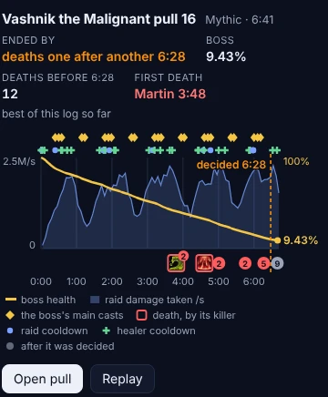

  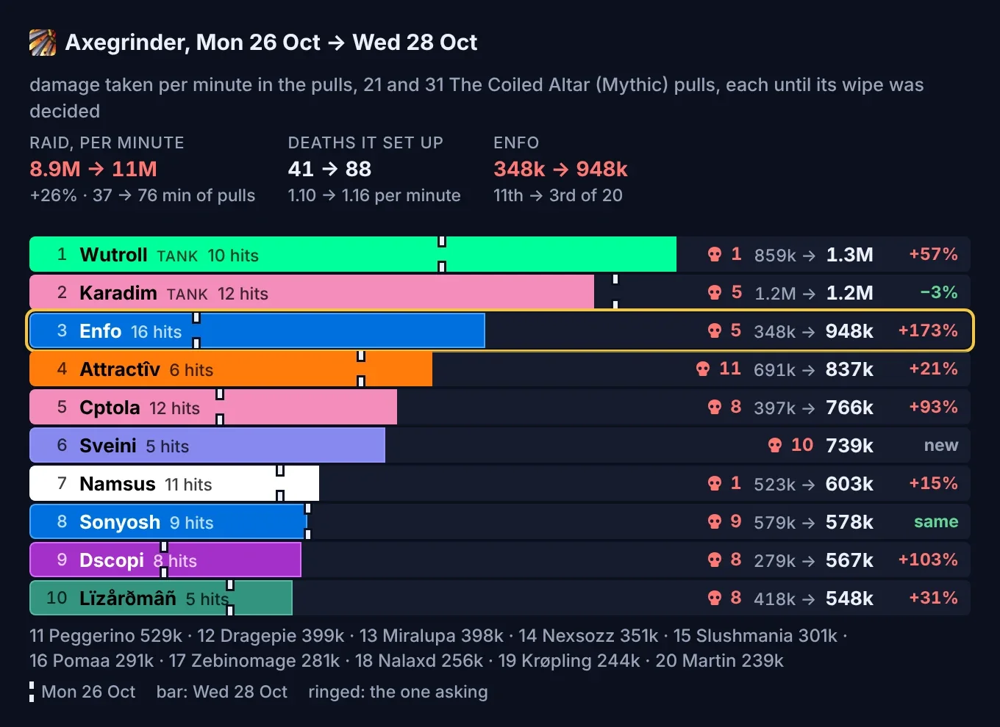
- `Agent` **Small slips in the wording are gone.** A night of nearly three hours reads "2:54:43", not "174:43 long", and a parse reads "81st percentile", not "81th". No more "(Mythic) (Mythic)", and the night's first wipe no longer carries a best mark. An enemy nobody hit "took no damage". Counts read "×2" and seconds "3 s". A dungeon run is read as one boss pull. A death with no killing blow reads "no killing blow recorded". Healers in a damage spike and before a death are named "Holy Paladin", not "Providence (Holy)". A date before 10:00 UTC, still the evening before in the Americas, now carries its time and "UTC".
- `Agent` `Discord` **Your Warcraft Logs sign-in and your private reports stay yours.** Everything read for an answer is read as its asker, and its buttons as whoever clicks them, no longer with the sign-in of whoever asked first since the bot started. Signed in with `/login private:True`, you can ask about a private report by its link in a server that isn't set up, and the answers work in full, buttons included. A link Warcraft Logs won't show says so, with how to let Wipebot read a private one. Nothing a private report showed is recorded, and a report made private or deleted after it was read is dropped within a day, where it kept answering for up to 30 days.
- `Discord` **An answer that reads as one message is sent as one.** Discord counts the address behind every linked ability, so answers just over its limit went out as two messages: such an answer now drops its last links until it fits. A long answer cut inside a code block opens the block again in the next message. After a restart, the next question starts a new conversation on every bot, read with the messages before it as after a quiet quarter of an hour.
- `Discord` **A bot many servers share keeps up with each of them.** Two servers that follow the same report each get their posts after wipes, where only the first did, and many questions at once no longer slow the bot down for every server. At most eight questions are answered at once, and one raider gets three at once and thirty an hour. On a bot where each server brings its own AI key, `/help` opens by saying an admin adds one with `/wipebot setup`, and What's new posts the changelog's own lines.
- `MCP` **Charts work with the keyboard and a finger, and the replay fits in fullscreen.** Tab stops on each chart, the arrow keys step through its marks and Enter opens a pull; on a phone a tap on a night's thin bar says which pull it is, and a second tap opens it. A screen reader hears each mark, and buttons are a finger's size. The replay opens in fullscreen from its own button with play and the timeline in sight.

  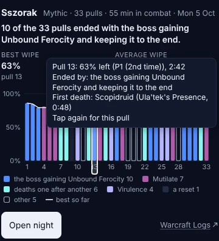

  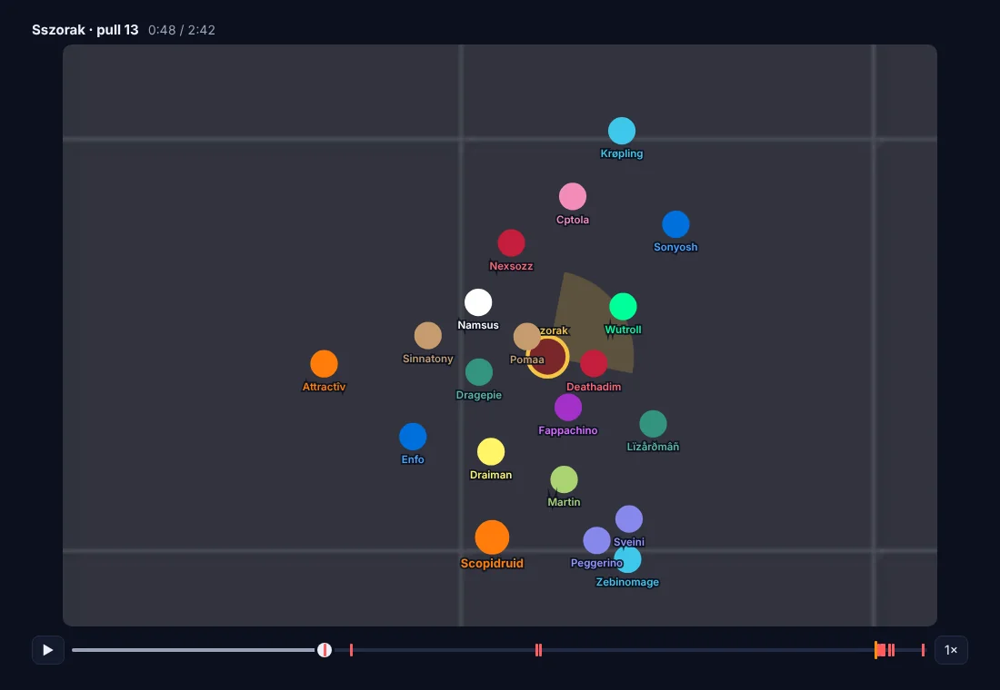
- `MCP` **Claude offers to send a report when you say an answer was wrong.** In Claude, which may load a connector's tools only when it searches for them, the way to send a report on an answer to Wipebot's maintainers now loads first, so the offer is made. Past the hourly limit per user, the refusal says what was asked for and what the limit is, and how long to wait until enough of it is over an hour old. A spell's tooltip or a spec's guide still answers once Wipebot has used up its Warcraft Logs reads for the hour.

## [0.41.1] - 2026-11-09

### Fixed

- `Discord` `MCP` **A key's limit set as a budget on OpenRouter is read again.** OpenRouter now keeps a key's limit in its budgets, so `/usage` showed nothing left on a key with money on it, and the live questions in the website's demo stayed off.

## [0.41.0] - 2026-11-08

### Added

- `MCP` **Try Wipebot on its website.** [wipebot.enfo.dev](https://wipebot.enfo.dev/#try) now has a demo: pick a question about a real Mythic night and read Wipebot's answer at once, pictures included, or sign in with Warcraft Logs to ask 3 questions of your own a month, about that night or a report of yours.

  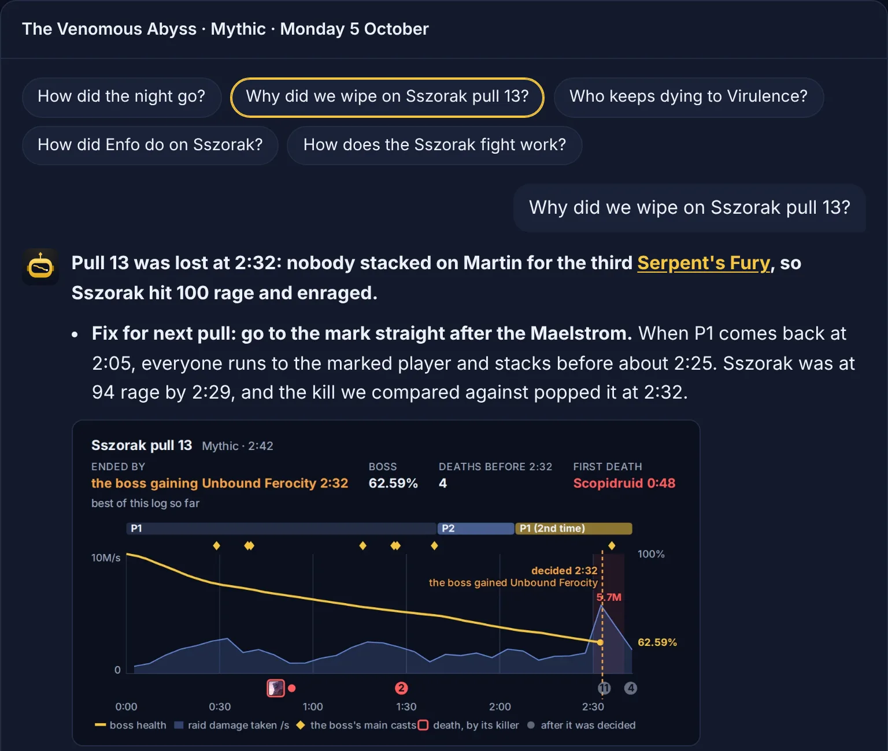

## [0.40.0] - 2026-11-08

### Changed

- `Discord` **One command for admins: `/wipebot setup`.** On its own it shows how the bot is set up in the server, what's left to do first on a new server (add an AI key, connect the guild), and buttons to add, change or remove the server's AI key. Its options change a setting, now with `news:` for the channel where what's new is posted. `/wipebot settings`, `/wipebot key` and `/wipebot news` are gone, and `/wipebot usage post` is now a button admins see under `/usage`.

## [0.39.1] - 2026-11-08

### Fixed

- `Discord` **Signing in with OpenRouter in `/wipebot key` is retried.** The key OpenRouter made for the sign-in could be refused for the first moments, so the bot said it didn't work and saved nothing. It now checks it again for a few seconds.

## [0.39.0] - 2026-11-08

### Changed

- `Discord` **The public Wipebot bot answers on your server's own AI key.** The small monthly share of free answers is gone: an admin adds an OpenRouter or Anthropic key with `/wipebot key`, and until then the bot says so. `/usage` and `/wipebot usage post` show what's left on the server's own OpenRouter key, and the bot says when that key's credit is used up.

## [0.38.0] - 2026-11-05

### Added

- `Discord` **Wipebot reads the pictures you send it.** Attach your stat sheet, a screenshot of your debuffs or the meter to a question, and the answer goes by what's on it. Before, the bot didn't see them. Up to 4 per question.

### Changed

- `Discord` **A shorter `/usage`.** The AI budget, the Warcraft Logs points and a server's free answers now say only what's left, without the limit they're out of, and the budget no longer adds up what was spent in all.

### Fixed

- `Discord` **The bot says when its budget is used up.** With the AI budget spent, the bot answered that it couldn't reach Claude; it now says it's out of credit for answering, and `/usage` shows the budget.

## [0.37.1] - 2026-11-05

### Fixed

- `Agent` **A player's stats come from their gear.** The stats the log gives at the pull can be far from what a player's gear gives: a Balance Druid was told their stats were skewed toward Mastery from the log's 2,925 Mastery, when their pieces give 969. The build comparison now sums the stats of each piece, and says the log's numbers can differ.
- `Agent` **Maps at a mechanic the raid stopped.** Asking where everyone stood when Eternal Nightfall began said it never happened, since the cast is never finished when the raid breaks the shield. A map at an ability given by its number also works again.

## [0.37.0] - 2026-11-05

### Changed

- `Discord` **Fewer pictures with answers.** The bot posted a chart with almost every answer, even a yes or no, a count, a gear or rotation question or a follow-up about something it had just drawn. It now posts one only when the picture shows something the text can't, like a ranking, a night pull by pull or a pull over time, or when you ask to see it. Posts after a wipe keep theirs.

## [0.36.0] - 2026-11-04

### Added

- `Agent` **The build comparison shows each piece of gear with its stats.** Asking about a player's gear against the top now lists every slot with the item, its item level and its secondary stats as worn (a crafted piece's chosen stats, an upgraded piece's level), so the bot can say which piece gives the stat a raider is short of, not only the totals.
- `Agent` **Damage on one enemy.** Asking who did the most damage to one add or one boss of a council, over a pull, a night or a few seconds of each pull, now counts only the damage on that enemy.

## [0.35.8] - 2026-11-04

### Fixed

- `Agent` **Damage and healing over a night show each player's rate over the pulls they were in.** A player who sat out some pulls was shown only at their rate over every pull, as if they did nothing in the ones they missed: a Retribution Paladin in 20 of 28 pulls showed 168k/s, where they did 215k/s in their own. Such a player's row now says how many pulls they were in and their rate over those.
- `Agent` **A buff the boss gains as a phase begins isn't what ended the pull.** The Coiled Altar gains Soulbound as Stage Three starts, so a pull that reached it was said to end on that buff like an enrage, and every death after it was left out as fallout. The bot then said Soulbound ended the night's best pull, when Venom Rupture killed the raid 13 s later. Such buffs now count as part of the phase.

## [0.35.7] - 2026-11-03

### Fixed

- `Agent` **Cooldowns and defensives are back.** Lorrgs moved its game data to new addresses on 2 November, so since then answers had no major cooldowns, defensives, raid cooldowns or boss timeline to go on, and said the cooldown timing couldn't be fetched. They're read from the new addresses again.
- `Agent` **Bloodlust from an Evoker counts.** Fury of the Aspects refreshes itself every few seconds in the log, so asking whether Bloodlust was up at a player's casts said it never was when an Evoker cast it.

## [0.35.6] - 2026-11-03

### Fixed

- `Agent` **A PvP talent isn't a missed cooldown.** Lorrgs still lists some PvP talents among a spec's cooldowns (Emerald Communion for a Preservation Evoker), so a raid log showed them as never pressed, and the bot told a healer to use one for mana. They're now listed with the cooldowns the player's talents leave out.

## [0.35.5] - 2026-10-31

### Fixed

- `Agent` **Kicks on adds are counted.** An add that logs a cast of the same name as it's kicked (The Coiled Altar's Spiteful Soulcoiler and its Wail of Terror) had every kick counted as a cast gone through, so the bot said 2 of 169 Wails were kicked where 89 were, and told a raid to set up a kick rotation it already had. The adds' casts, who had a kick ready and the raid note's kick checks now count them as Warcraft Logs does.
- `Discord` **A suggested follow-up keeps what came before it.** Clicking one after a long conversation had started over lost the earlier messages, so a follow-up about a log linked earlier was answered about the guild's latest raid instead, or said the player wasn't there.

## [0.35.4] - 2026-10-29

### Fixed

- `Agent` **Talent forms of a spell are counted.** A Devourer's Reap and Cull after a full Void Ray become Eradicate, which the log records with no cast, so the comparison with top players missed every one and read Cull as "far fewer". They now count with the spell, for the player and the top players. When a player has none of a spell asked about (Curse of Tongues), the breakdown names what they had instead (Curse of the Satyr, which does its job), and a raid note's spell a player never cast all night says another spell may do its job.
- `Agent` **Resource lost at the cap isn't called a fault on its own.** The lines on Fury, Holy Power or other resources lost at the cap now say that some of it comes with the spec and the fight, and that top players' time at the cap shows how much is left to win back.

## [0.35.3] - 2026-10-29

### Fixed

- `Agent` **"Who did the least damage?" shows the bottom of the meter.** Asking for the least damage or healing now ranks only the damage dealers (or only the healers), least first, and the meter is drawn from the bottom: the lowest players get the bars and the top ones the line under them. Before, the meter showed the top ten with tanks and healers below the damage dealers, and the player the answer named only in the small print.

  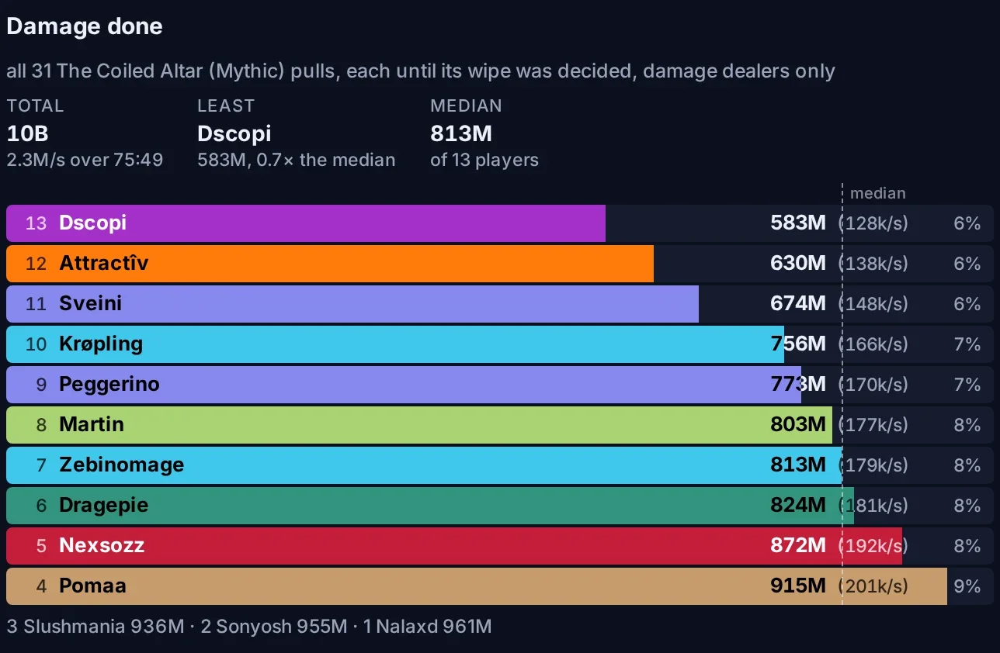

## [0.35.2] - 2026-10-29

### Fixed

- `Agent` **A new guild best is called one.** A night's pulls now say themselves whether the night's best wipe beat the guild's best before it, and mark the pull that did, so "P2 64.0%" against Monday's "P2 68.3%" can't be read backwards as a miss. Night by night, a night that got further than every one before says so too.

## [0.35.1] - 2026-10-29

### Fixed

- `Discord` **Norwegian answers keep the game's English words.** Answers and what's new posts in another language no longer translate the terms raiders say in English: "holy paladin", not "hellig paladin"; "guild", "armor", "pulls" and "healere", not "gild", "rustning", "trekk" or "helere".

## [0.35.0] - 2026-10-29

### Added

- `Agent` **Top players from raids with your healer count.** Comparing a healer's casts with top players now takes top parses from kills with as many healers as their raid had, and you can ask for any count: "the best holy paladin in a 5-heal kill?" is one ranking, where it took a minute and a half of hand-made queries.
- `Agent` **A night's pulls say what ended each.** The list of pulls now gives each one's ending and when the wipe was decided, and how many pulls ended in each phase, so a wipe isn't blamed on a death a minute before it was decided; a mechanic's hits over the night add the raid's totals pull by pull.
- `Agent` **A player's night says which deaths a defensive would have saved.** It now gives how many of their deaths a ready defensive or a healthstone would have survived, and on which pulls, and their best pull is one long enough to judge (a minute or more), not a 30-second wipe of opening burst.

### Changed

- `Agent` **A night's picture counts a wipe by its phase.** On a boss with phases, the night's best wipe and the guild's best before it now read as raiders say them ("P2 64%"), with Warcraft Logs' % in each pull's tooltip, and the guild's best in the text gives its phase too; a player's night does the same.

  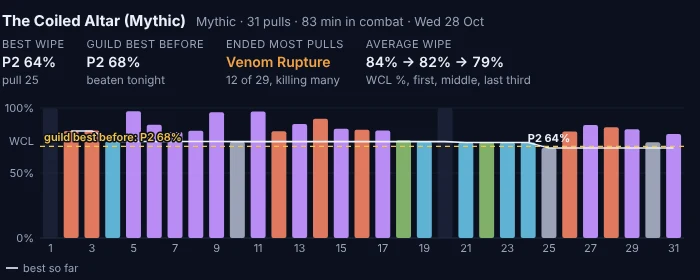

### Fixed

- `Agent` **Orb carriers aren't blamed for their own orb.** A damage over time that ticks as it's put on a player, like the Coiled Altar's Mutagenic Venom, was counted as hitting them from another carrier whose orb ran out at the same moment, even 75 yd away; it's now their own. Over a night, each such hit also says how far apart the two stood.
- `Agent` **Healing by spell keeps procs apart.** Warcraft Logs folds some spells into another's row (Overflowing Light's absorbs under Holy Shock, a shaman's Tidewaters under Healing Rain), so a breakdown by spell counted them as that spell's heals; each now has its own row, and an item's effects carry its name.
- `Agent` **A player's spec is the one they played in the pulls asked about.** A healer who tanked another boss that night was called "also Protection in some pulls" over a night they healed throughout, and in Discord got a tank's icon.
- `Discord` **Pull links open the pull named.** A link to "pull 12" without the boss's name opened pull 12 of whichever boss came first in a night of several bosses; it now opens the boss the answer read, and a pull it can't place stays plain text.
- `Discord` **What Wipebot remembers is about the asker.** A raider's note could rename another raider, in a channel and in that raider's own answers; notes are now only how to answer the one who asked.
- `Agent` **A potion drunk before the pull isn't "never cast".** Comparing casts with top players flagged a pre-pull potion as never cast; a buff up as the pull began now reads "cast before the pull", and neither it nor an item not worn is marked red.
- `Agent` **Time at the resource cap is weighed against top players.** A player's pull called Fury capped 19% of it a fix when top players of the spec cap as much on that boss; it's now flagged only beyond theirs, with their share beside it.
- `Agent` **Personals checks know the rest of the note.** A player who pressed the raid cooldown the note plans for them at a "Big Personals" callout, or a tank who kept a cooldown for the hit just after, was marked as missing it; they're now counted apart, in the text and in blue on the Personals picture.

  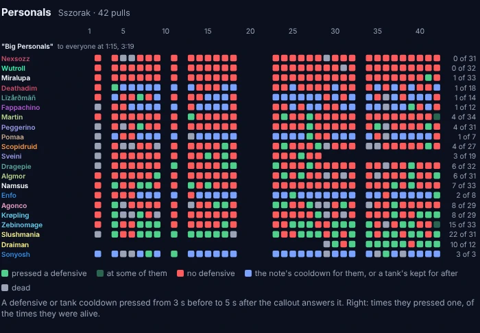
- `Agent` **Loot doesn't guess a difficulty's item level.** When Wowhead's table of a boss's drops leaves out a difficulty (the Coiled Altar's had no Mythic row), the answer now says it isn't known instead of working one out, and an item's worth goes by the raider's own sim at the level they'd get it at.
- `Agent` **A boss's guide is the one for the difficulty you're on.** Asked during a first Mythic pull, the guide for a boss cleared on Heroic earlier that night came as Heroic's; it's now the hardest difficulty the night pulled the boss on. A mechanic named under the wrong boss is looked for in the night's raid first, which is faster.

## [0.34.0] - 2026-10-28

### Added

- `Agent` **Compare a mechanic with another night.** "Did I take less Axegrinder than on Monday?" now gets each night per minute of the pulls, so a longer night doesn't look worse: the raid's and each raider's, their rank both nights, hits and the deaths it set up. In Discord it's one meter: tonight's bars, a tick at Monday's, and the change.

  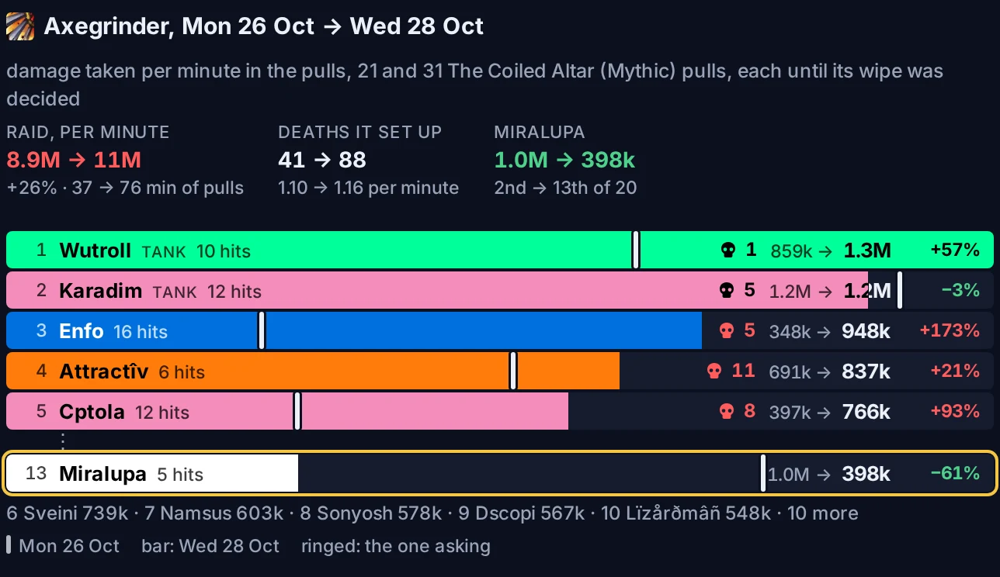

### Changed

- `Discord` **Fewer pictures per answer, after the point they back.** An answer posts one view, not the same meter again for another night; a mechanic's hits pull by pull are a button under its meter; two nights' best pulls aren't drawn as a picture of two bars; and a picture comes after the bullet it backs instead of between the headline and the answer. The asker's own row is ringed in a meter, and shown under the top ones when they're further down.

  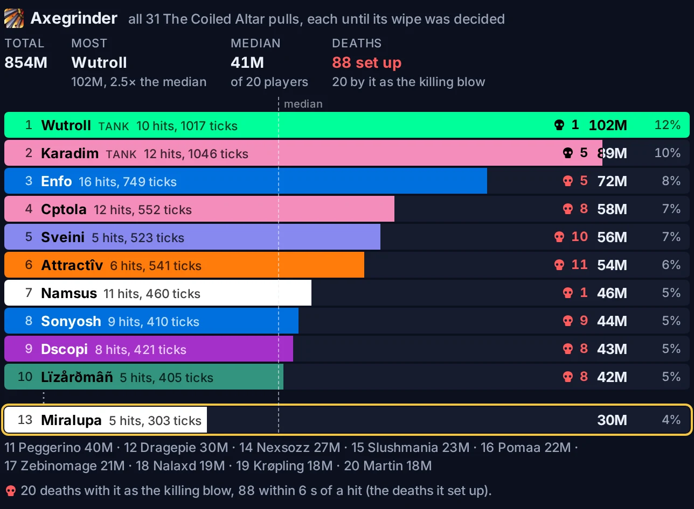
- `Discord` **Buttons say where they go.** "My night on The Coiled Altar", "First death: Karadim" and "Open a pull on The Coiled Altar…" instead of "My night", "First death" and "A pull".

## [0.33.0] - 2026-10-28

### Changed

- `Agent` **Meters in the real class colours.** Each bar is drawn in its class's in-game colour, as damage meters do, with the name on it in black or white, whichever reads on that colour. In the light theme a bar gets an outline a shade darker, so a priest's white shows where it ends.

  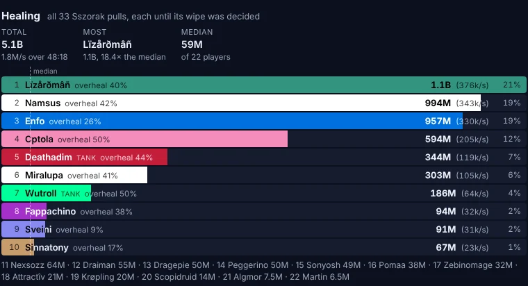

## [0.32.0] - 2026-10-28

### Changed

- `Discord` **Names in channels.** Wipebot names players in a server channel as it does in a DM: "who took the most damage?" or "who missed kicks?" is answered right where it's asked, instead of being sent to your DMs. It still answers in your DMs when you ask it to.

## [0.31.1] - 2026-10-28

### Fixed

- `Agent` **A cooldown on the other side of a talent choice isn't counted as missed.** A Holy Paladin with Avenging Wrath was told they used Avenging Crusader 0 of 5 times; talents whose spell is cast under another id than the tree grants are now known as not taken.
- `MCP` **The player card's cooldowns no longer pile up.** Icons used close together stack in rows, each cooldown is named once in the legend by its icon, a spell never cast still gets its icon against top players, and labels keep clear of the next mark.

  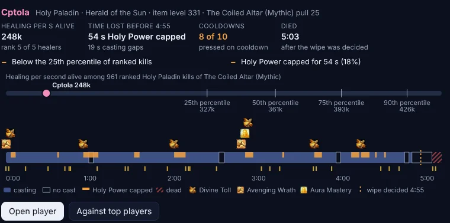

## [0.31.0] - 2026-10-28

### Changed

- `Discord` **The personals picture shows defensive or not.** A raider who pressed some other cooldown at the callout is drawn red like one who pressed nothing, instead of in a colour of its own.

  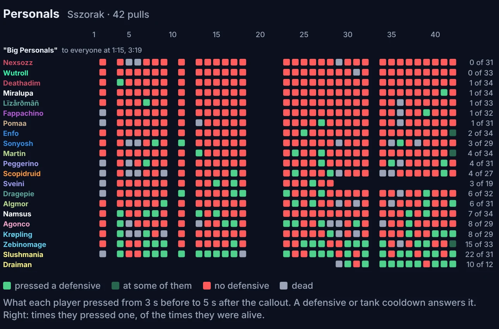

## [0.30.3] - 2026-10-28

### Fixed

- `Discord` **A question about personals gets only the personals picture.** When an answer doesn't say which of the raid note's pictures it means, it gets the ones its headline is about, instead of kicks, cooldowns and personals all at once.
- `Agent` **Only callouts that say kick count as kick assignments.** A job timed with an add's cast, such as "CC Mindcontrol", was checked and drawn as a kick nobody made; it's now listed as a callout not checked.

## [0.30.2] - 2026-10-28

### Fixed

- `Agent` **Only callouts for personals are checked.** A callout asking for something the log can't match to a press, such as grabbing an orb or CCing a mind-controlled player, was judged by whether the player pressed any cooldown around it, which said nothing. It's now listed as not checked, and the raid note's callouts picture shows only the personals.

  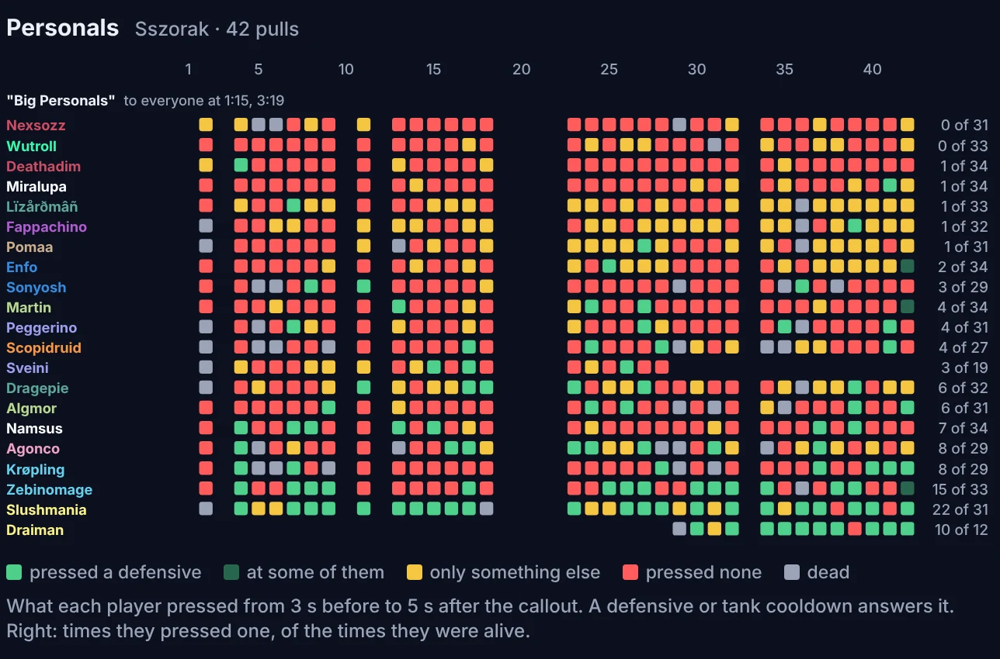

## [0.30.1] - 2026-10-28

### Fixed

- `Discord` **Ask right after a wipe.** A question now reads the live log again as it comes in, so it sees a pull as soon as Warcraft Logs has it (about 5 to 10 seconds after the pull ends), instead of sometimes missing it for up to 30 seconds more when someone else had just asked.

## [0.30.0] - 2026-10-28

### Changed

- `Discord` **Damage and healing meters together.** Ask for the best DPS and HPS and the answer posts both meters, the top five of each, instead of only the damage meter, and the text no longer lists them again. A meter on its own still shows the top ten.

  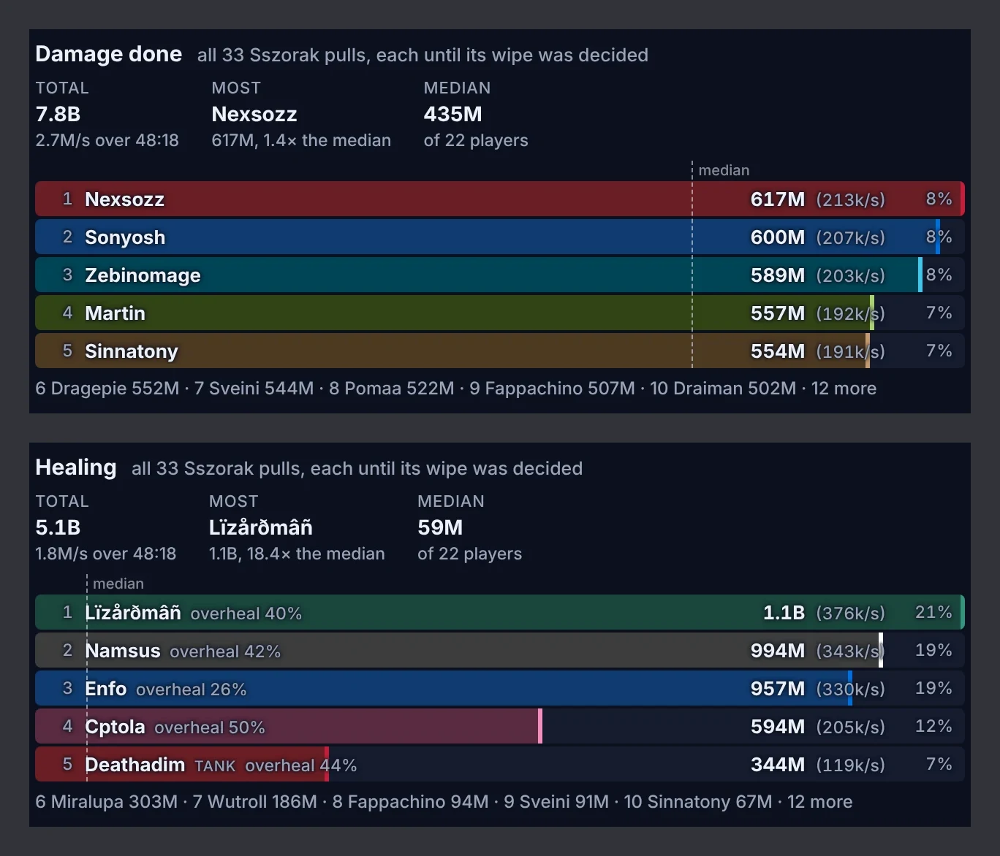

## [0.29.0] - 2026-10-28

### Fixed

- `Agent` **"Did people press personals?" counts only defensives.** A callout asking for personals or defensives counts a player only when they pressed a defensive (or a tank cooldown), not any spell; those who pressed something else instead are named apart.

### Added

- `Discord` **The raid note's callouts, pull by pull.** Over a night, each callout's players are drawn pull by pull: pressed what answers it, only something else, nothing, or dead, with how often they answered. An answer about callouts posts only this picture, not the kicks and cooldowns ones, and kick assignments or callouts fewer than three pulls reached aren't drawn (a late one-off drew one huge column).

  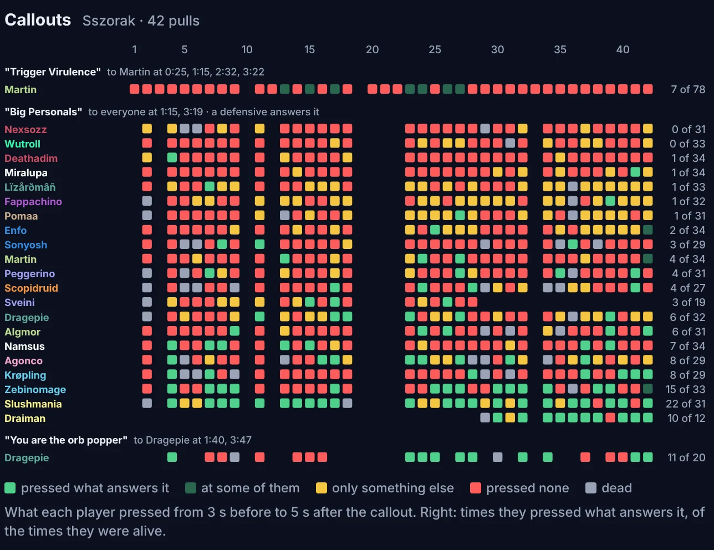

## [0.28.1] - 2026-10-28

### Fixed

- `Agent` **The pull picture counts a wipe by phase.** On a boss whose phases each have their own health bar, such as the Coiled Altar, the pull's card says "P2 80.8%" instead of a bare 80.8% next to Warcraft Logs' whole-fight %s, which it now names "WCL". Its boss health line follows the next phase's boss instead of stopping at 0% when the first one dies, and answers say the phase with the %.

  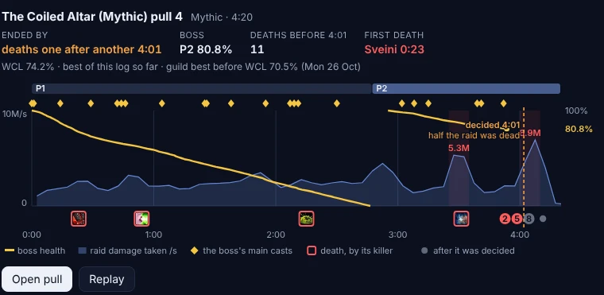

## [0.28.0] - 2026-10-28

### Changed

- `Discord` **What's new posts only what raiders care about.** A release whose changes are small tweaks or behind the scenes posts nothing in the what's new channel; its changes wait for the next post.

## [0.27.0] - 2026-10-28

### Added

- `Discord` **Your own guild, without setup.** In a server where nobody ran `/wipebot setup`, a raider signed in with `/login` asks "why did we wipe?" or "how did the night go?" without a link: the bot finds their guild's live report or latest night, from the characters they claimed on Warcraft Logs (their remembered character's guild first). Posts after wipes and raid notes still need setup. Signed in before? Run `/login` again so the bot learns your guild.

## [0.26.0] - 2026-10-28

### Changed

- `Discord` **What's new comes with minor releases only.** A patch posts nothing in the what's new channel: its changes come in the next minor release's post, which covers everything since the last one.

## [0.25.1] - 2026-10-28

### Fixed

- `Agent` **A defensive pressed just before a debuff lands.** "Was my bubble up for the orb?" reads a debuff on the player (a boss's mark) as well as a buff, and says when it came on while the defensive was still up, where before a bubble pressed a second early read as not covering it.
- `Agent` **A mechanic asked about on the wrong boss.** Asked for a mechanic under a boss that doesn't have it, Wipebot finds the raid boss that does and reads its guide, instead of trying boss after boss.
- `Discord` **Out of credit, without "this month".** When the bot's AI key runs out, raiders are told it's out of credit and that `/usage` shows the budget, instead of "this month", which was wrong for a budget that doesn't reset.
- `Discord` **"It's on its way to your DM".** Asked to answer in DMs, the bot says the answer is on its way, not that it was sent while it was still being worked out.

## [0.25.0] - 2026-10-28

### Added

- `Discord` **The steps an answer went through, kept under it.** An answer ends with a small line of what it looked at, like "✓ Raid note · ✓ Roster · ✓ Compare with top players ×2", the steps shown while it was written. `/wipebot setup steps:` turns it off for a server.
  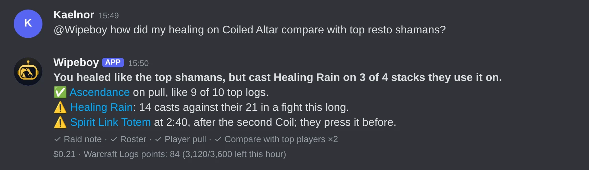

### Changed

- `Discord` **Clearer pictures.** The damage meter draws every class's bar at one lightness with the class colour as its end cap, so names read as well on a priest's bar as on a warlock's; the raid's night colours only the four most common ways pulls ended (the rest grey) and its list of endings is the legend; a raider's plan map over the night says what green and red mean and labels only their three furthest misses.
  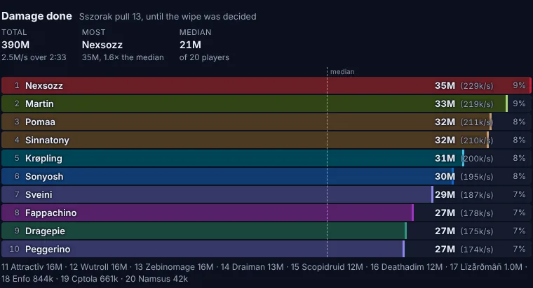
- `Agent` **Overheal read the way healers read it.** Overheal is no longer treated as a healer's fault or compared across specs: it costs only when mana runs out or healing falls short in the damage spikes, and whether the raid needs another healer is read from the spikes. Each healer's healing with overheal comes per second from the log, not worked out from rounded percentages.
- `Agent` **Pushback checked point by point.** When a raider disagrees or adds what they know, Wipebot checks each point: it changes what the new fact changes, keeps what the log still supports, and says which points it couldn't check instead of agreeing to all of them.

## [0.24.1] - 2026-10-28

### Fixed

- `Agent` **The guild's raid night, not the Heroic run after it.** Asked about the latest raid without a report, Wipebot takes the newest night on the difficulty the guild raids (Mythic, say), not a Heroic or alt run raiders logged to the guild's page the day after; and the guild's report list marks such a run as an easier one, not the raid night.
- `Discord` **Only the pull the answer is about under it.** A question about other guilds' logs or the game no longer comes with the guild's own pull the bot looked at on the way.

## [0.24.0] - 2026-10-28

### Added

- `Agent` `Discord` **Healers' mana and Innervate.** "Was I out of mana, and could I have had an Innervate?" is answered from each healer's mana until the wipe was decided, how low it went and from when, and each druid's Innervate: when, on whom and at what mana, or ready while a healer was under 30%; over the night, the pulls each healer ran low and whom the Innervates went to. In Discord, drawn as a picture.
  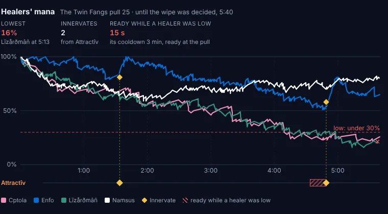

## [0.23.0] - 2026-10-28

### Added

- `Discord` **Who does what, before the pull.** Asked about the next raid or a boss not pulled yet, the bot draws the saved raid note: each player's row under tanks, healers and damage, their planned cooldowns and callouts at their times, and their jobs and groups under their name.
  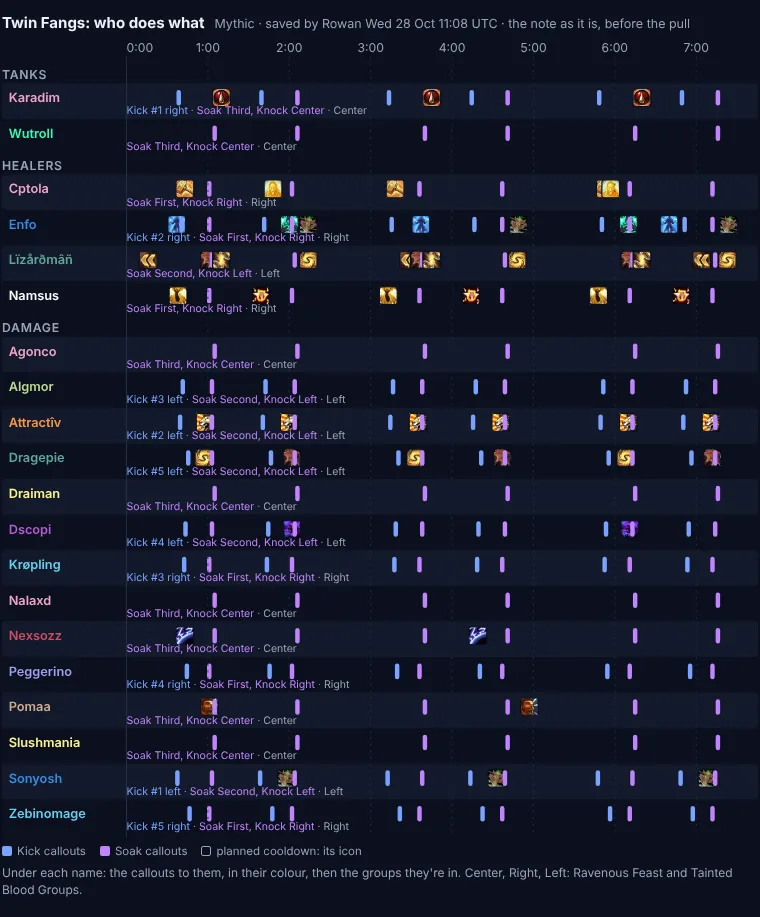
- `Agent` `Discord` **Head-to-head with a raid mate.** "Why does Zebinomage do more than me?" sets two raiders side by side, on a pull or every pull on the boss both played: damage or healing per second alive, time alive, deaths, item level, and per spell casts per minute, average hit and crit, what's far apart marked; in Discord, drawn as a picture.
  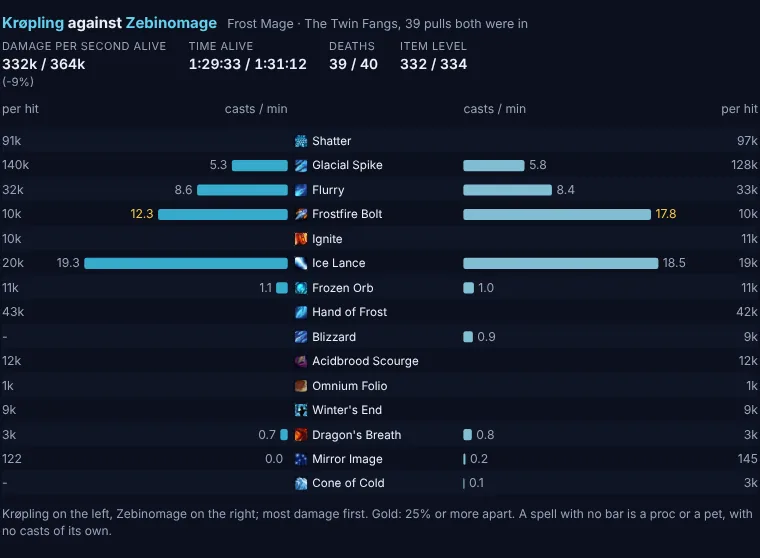

## [0.22.0] - 2026-10-28

### Added

- `Discord` **The raid note over the night, drawn.** Checking a raid note against every pull on a boss now posts two pictures: each kick assignment pull by pull (kicked, covered by another, went through, with the first cast that went through before a wipe ringed and counted by player), and each planned cooldown pull by pull (on time, a little off, late, not cast).
  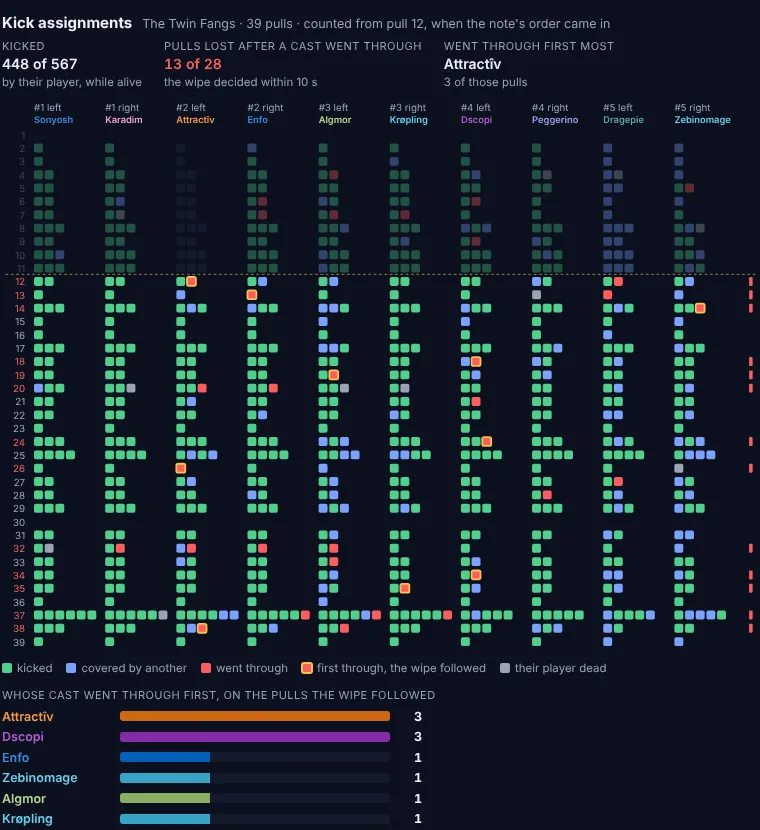
- `Discord` **Who gets hit, pull by pull.** A mechanic's hits over the whole night add a second picture under the meter: each player's hits on each pull, the ones that led to a death marked, and the raid's total per pull.
  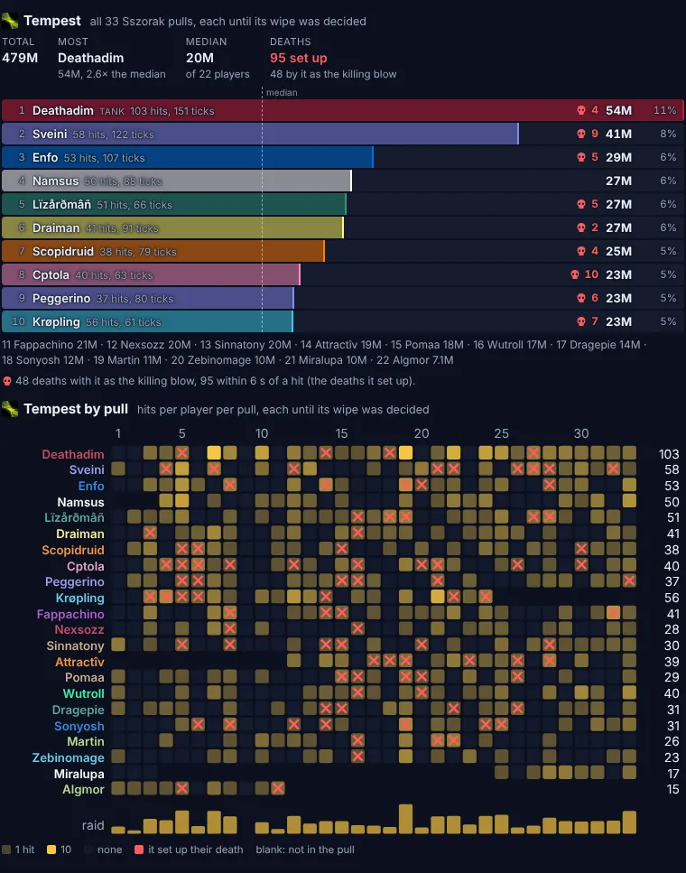
- `MCP` `Discord` **Damage spikes on the pull chart.** The pull's chart marks each moment of raid damage taken at twice the usual or more, with its value, and lists the healer cooldowns used in the 10 seconds before it.
  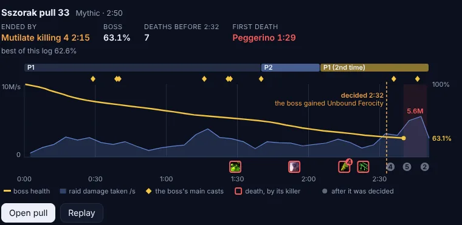
- `Discord` **What's new, in a channel of your choice.** An admin picks a channel with `/wipebot news`, and each new release posts there every change raiders would notice, a line each with its pictures. Off until an admin turns it on.
- `Discord` **The server's language.** `/wipebot setup language:Norwegian` writes what's new and the posts after wipes in it, and answers a question whose language doesn't show (a bare report link) in it; a question is still answered in its own language.

## [0.21.0] - 2026-10-28

### Added

- `Agent` **Raid damage at a moment.** "What was our raid DPS at 2:15 on pull 16?" is answered from the damage in a window of the pull, in a few seconds rather than a minute of the model working it out from raw data. Damage, healing, damage taken and casts all take a window, and a table of damage or healing now starts with the raid's total and per second.

## [0.20.0] - 2026-10-28

### Added

- `Agent` `Discord` **A saved raid note older than Viserio's says so.** On a guild whose host connected its Viserio Cooldowns key, a note checked against a pull, or given for the next raid, says when the note was changed in Viserio after the copy Wipebot has was saved, so an officer knows to paste the new one.
- `MCP` `Discord` **Private reports.** Wipebot can read the private Warcraft Logs reports you may open, once you allow it: at `/wcl/private` on the connector's server (Claude and ChatGPT), or with `/login private:True` in Discord. It's a second Warcraft Logs sign-in, so members who only read public logs never see it. A private report is read only for your own questions, never cached or shown to anyone else, and the records of those questions leave out what it showed.

### Changed

- `Agent` **How many were on their spot.** A check of a raid plan against a pull says, at each moment, how many players were on their spot out of those placed, so an answer's headline matches the count.
- `Agent` **What holds off the enrage.** When a boss's enrage ends most pulls of a night, the review looks up what holds it off (a stack, a soak, a kick) and puts that first, before the deaths that left it short.
- `Discord` **Tighter answers.** Only the opening verdict's first sentence is bold, bullets are at most two short sentences, and answers no longer end on what only the raiders who were there could know. A player's or boss ability's icon shows on its first mention only.
- `Discord` **Buttons in your language.** A Norwegian answer's buttons are Norwegian ("Åpne i Warcraft Logs", "Mot toppene"), and a click's reply follows your Discord's language. Your own card offers **My night** instead of "Their night".
- `Discord` **The cost line comes last.** In an answer with a picture it sits under the follow-up buttons, below a thin line.
- `Discord` **Shorter meters.** A ranking of players draws the top 10 as bars and the rest on one line, so it no longer fills a phone's screen.

## [0.19.0] - 2026-10-28

### Added

- `Discord` **Post the AI budget.** Admins can post what the bot has spent and has left to the channel with `/wipebot usage post`, with a bar of how much of the limit is spent. On the public bot it posts the server's share of the month's free answers.

## [0.18.0] - 2026-10-27

### Changed

- `Discord` **Quieter follow-up buttons.** The questions an answer suggests are grey buttons now, like the bot's other buttons, and clicking one takes off only that one: the others stay to ask next.

### Fixed

- `Discord` **Warcraft Logs points left, on a shared bot.** The cost footer and `/usage` count the bot's own share of the hour's points, on a copy that has one (`WIPEBOT_WCL_SHARE`), instead of the whole account's.

## [0.17.0] - 2026-10-27

### Added

- `MCP` `Discord` **Wipebot has a logo.** A bot whose screen shows a boss's health falling, for the Discord app, the website and the connector: the server names it as its icon for the apps that show one. Its files are in [docs/brand](https://github.com/Enf0/wipebot/tree/main/docs/brand).
  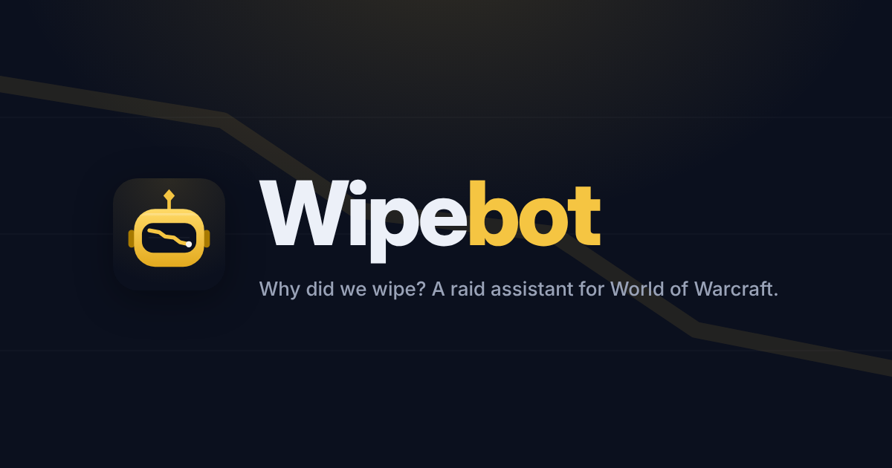

### Fixed

- `Discord` **Questions without a report.** Wipebot answers questions about the game, a class or a boss without a Warcraft Logs report, in a server not set up or before the guild's first raid, instead of only asking for a report link.
- `Discord` **/wipebot key on a guild's own bot** says there's nothing to do and no longer offers to sign in with OpenRouter, which would only swap the host's key for another.
- `Discord` **The cost footer's Warcraft Logs points.** They're counted once (they were added up several times over) and show what the bot has left this hour, like "80 (3,120/3,600 left this hour)", with your own apart when you're signed in on Warcraft Logs' new point system.

## [0.16.0] - 2026-10-27

### Added

- `Discord` **Sign in with Warcraft Logs in Discord.** `/login` signs you in, as Claude and ChatGPT already do: your own Warcraft Logs points then pay first for what you ask, so the bot's last longer for everyone, and `/usage` asks Warcraft Logs whether yours are left. Hosts turn it on with `WIPEBOT_WCL_CALLBACK` ([setup.md](https://github.com/Enf0/wipebot/blob/main/docs/setup.md)).

### Changed

- `Discord` **The cost footer is a setup option.** `/wipebot footer` is now `/wipebot setup footer:`, beside the other settings.

### Fixed

- `Discord` **/wipebot key and /usage on a guild's own bot.** `/wipebot key` no longer says a guild's own bot answers from shared free answers, its buttons come in the order you use them, and `/usage` names no other bot.

## [0.15.0] - 2026-10-27

### Changed

- `Discord` **No more names in chosen channels.** `/wipebot names` is gone: in every channel Wipebot names nobody and says what went wrong and how to fix it, and in a DM it names players, as before. Ask it in a channel to answer in your DMs for who missed what.

### Fixed

- `Discord` **0.14.0's slash commands show up.** Discord turned down 0.14.0's commands over one description too long, so `/help`, `/usage`, `/wipebot key` and `/wipebot footer` were missing.

## [0.14.0] - 2026-10-27

### Added

- `Discord` **`/help` and `/usage` for everyone.** `/help` says what to ask, with examples, which commands you can use and how the server is set up; saying "help" to the bot gives the same at once. `/usage` shows how many Warcraft Logs points are left this hour and when they come back, next to the AI budget below. Every command is listed in [features.md](https://github.com/Enf0/wipebot/blob/main/docs/features.md#discord-commands).
- `MCP` **Tell Wipebot an answer was wrong.** In Claude and ChatGPT, say an answer was wrong, missed something or took too long, and Wipebot offers to send a report to its maintainers: your question, the answer and what you said about it, sent only once you agree. Claude and ChatGPT never show a connector the conversation, so this is how we see the answers that need fixing.
- `Agent` **Damage on adds, wave by wave.** Ask "who did the most damage on the last three sets of adds?" and Wipebot gives each wave's damage by player on a pull, on the adds of that wave alone.
- `Agent` **How much Holy Power each cast wasted.** Ask "how much Holy Power did my Divine Tolls waste?" or "how many Holy Shocks did I press at 5 Holy Power?" and you get what you had before each cast and what was lost at the cap right after, for Holy Power, Combo Points, Essence and the other resources.
- `Agent` **Healers in other guilds' progress kills.** Besides the fastest kills, Wipebot can now count what the latest or the first kills of a boss brought, up to 500 of them and by region: "how many healers did the last 20 progress kills on the Coiled Altar bring?", "of the first 400 kills in EU and US, how many 4-healed?".
- `Discord` **What an answer cost, under it.** `/wipebot footer` ends answers with a small line: their cost, their Warcraft Logs points and, on a bot many servers share, the server's free answers left this month. `/usage` also shows what the server spent this month.
- `Discord` **Bring your own key.** `/wipebot key` lets an admin answer the server's questions on its own OpenRouter key (sign in with OpenRouter, no copying keys) or an OpenRouter or Anthropic key they paste. It's kept encrypted and never shown again, and `remove:` goes back to the shared answers.
- `Discord` **Ask without setting the bot up.** In a server nobody ran `/wipebot setup` in, mention the bot with a Warcraft Logs report link and it answers about that report, follow-ups included. Setup still adds the guild's latest raid without a link, posts after wipes and raid notes.
- `Discord` **See the bot's AI budget, and chip in.** On a bot that answers through OpenRouter, anyone can run `/usage` to see what answering has cost this month, how much is left (and about how many answers that is), and how to contribute to it. Hosts set it up in docs/setup.md.

### Changed

- `Discord` **Viserio Cooldowns and raidstrats.gg are connected by the host only.** Both are still experimental, so `/wipebot viserio` and `/wipebot raidstrats` are gone; the host connects them on the command line (`wipebot viserio`, `wipebot raidstrats-login`), and keys already connected keep working.

### Fixed

- `Agent` **The boss's health at the end of a pull isn't cut off.** The pull's picture had too little room on the right for a value such as 62.59%, which lost its last digit in Claude and ChatGPT.
- `Agent` **Kills and experience for a raider who missed the night.** Asking about the season of a raider who isn't in the night's log (signed up, but out that night) now finds them on the guild's realm, instead of failing and searching other reports first.

## [0.13.0] - 2026-10-27

### Added

- `Agent` **See your progress on a boss night by night.** Ask "are we doing better on the Coiled Altar than last week?" and the picture now starts with your best pull of each raid night, named by the phase it reached ("P2 68%") and coloured by it, up to the kill. In Claude and ChatGPT, click a night to open it.

## [0.12.0] - 2026-10-27

### Changed

- `Agent` **Wipes on bosses with phases are counted the way raiders count them.** On a boss whose phases each have their own health bar, such as the Coiled Altar, a wipe reads "P2 68.3%", with Warcraft Logs' whole-fight % beside it, instead of only Warcraft Logs' 70.5%.
- `Agent` **Fewer "a healthstone would have saved you".** A healthstone, potion or heal now only counts when there was a second to press it before the killing hit, and only for the health that was missing then. A big hit from full health followed at once by a tick can't be healed through.
- `Discord` **A restart doesn't end your conversation.** When the bot restarts for an update, your next question or follow-up button goes on where the conversation was, instead of starting over without what it found.
- `Agent` **Ready for Warcraft Logs' new API limits.** Once the account moves to the new point system, Wipebot notices by itself: members signed in to the connector spend their own Warcraft Logs points first, and when the hour's points for rankings run out, an answer says rankings are back in so many minutes and gives the rest instead of failing. Raiders' character pages are read less often too.

## [0.11.1] - 2026-10-27

### Fixed

- `Discord` **Pictures sit next to what they show, now for real.** The bot rarely placed a picture inside its answer, so it still came at the end. Any answer longer than three bullets now puts its picture right after the part it backs, or else (when the bot leaves it out or puts it last) right under its first line.
- `Discord` **Asking a follow-up no longer brings up link previews.** Clicking a follow-up under an answer without pictures made Wowhead previews of its links appear under it.
- `Agent` **No advice to press a trinket you don't have.** Compared with top players, an on-use item they wear and you don't is marked as not worn, not as never pressed.
- `Agent` **Everyone's damage on the adds.** Asked who hit the adds on a pull, the answer has every player's damage on the most damaged kind, pets and totems included, instead of the top four and slow, wrong sums of its own.
- `Agent` **A cooldown written twice in the raid note isn't a miss.** A note that plans the same player's cooldown twice a second apart (0:42 and 0:43) made every pull look like one of them was never cast. They're checked as one use now, and the answer says the note lists it twice.
- `Discord` **Posts after wipes keep to what you asked.** Asked for a post only below 30 % or every 10th pull, the bot no longer posts after the other pulls, nor a message saying it won't post, and never an empty "(no answer)". The kill gets its post too.
- `Discord` **Notifications show the answer.** An answer without pictures is a plain message again, so a notification shows its text instead of nothing. Answers with pictures still show only "attached images": Discord doesn't let those carry a preview.

## [0.11.0] - 2026-10-27

### Added

- `Discord` **Pictures sit next to what they show.** An answer about more than one thing, such as two bosses, puts its picture right after the part it backs instead of under the whole answer.
- `Discord` **"How did I do?" after each wipe.** A post after a wipe in a channel, and every picture of a pull, has a "How did I do?" button: it shows you your own card on that pull, which only you see. It goes by the character the bot remembers for you; tell it once ("my character is ...").

  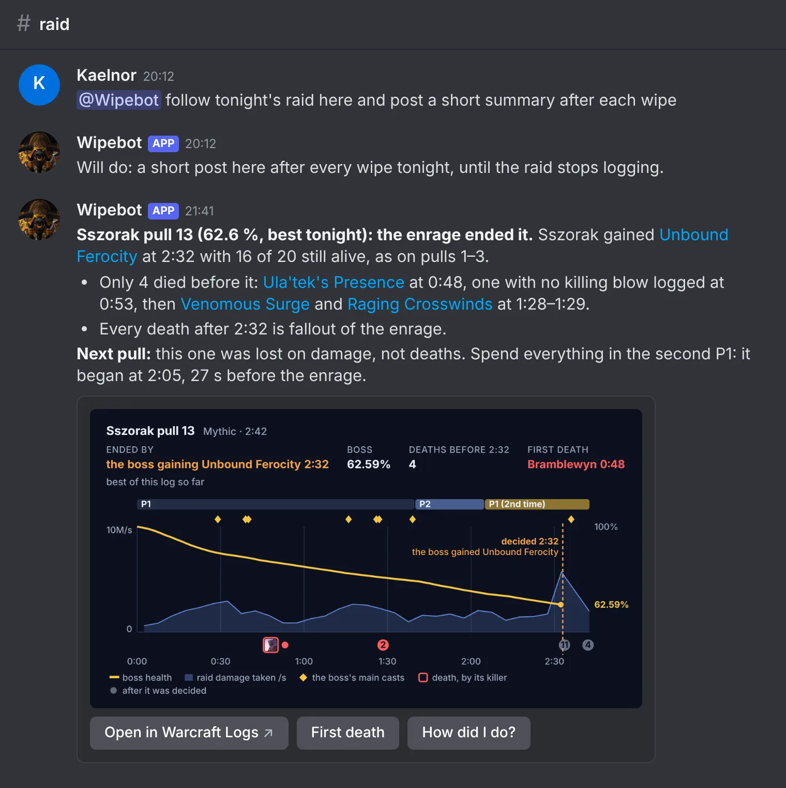
- `Discord` **Follow-ups are buttons.** Instead of ending with "want me to...?", an answer offers up to three follow-ups as buttons under it. Click one and it's asked for you, as if you had typed it; only the one who asked can click them.
- `Discord` **Rankings as a damage meter.** When an answer ranks players, such as who took the most damage from a mechanic, who did the most damage or healing, who kicked or dispelled, or who hit the adds, it comes with a picture like an in-game damage meter: a bar per player in their class colour with the amount, per second and share, the raid's median, and for a mechanic the deaths that came soon after a hit. The answer names the few that matter instead of listing everyone.

  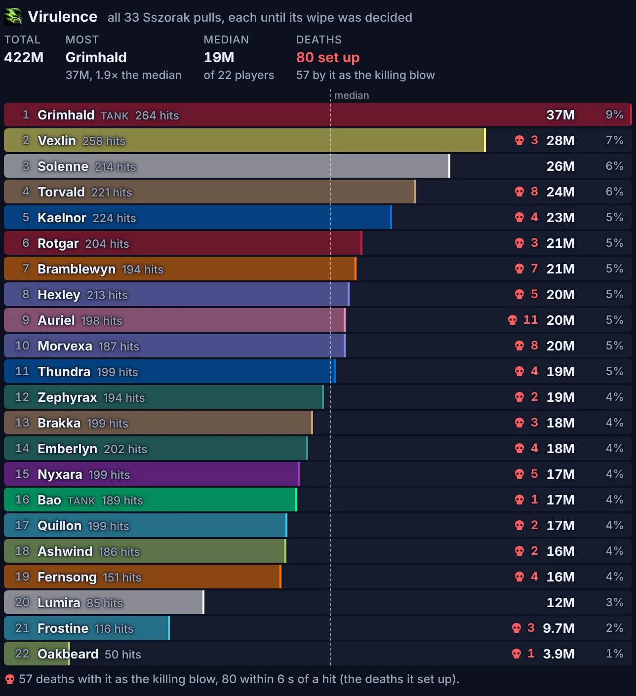
- `Discord` **Your night when the raid ends.** Where someone asked for posts after each wipe, the bot posts one last picture once the raid stops logging: in a channel, the night on the last boss, with **My night** for each raider's own card (only they see it); in a raider's own DMs, their night card.

### Fixed

- `Agent` **Dying in the hit that wiped the raid isn't on your card to fix.** A player's card listed a death to an ability that killed many at once, such as a missed kick letting Visceral Burst through, as their mistake. It now leaves it out: that hit wiped the raid, whoever's job it was to stop it. A death of their own before it still counts. The same now goes for a player's night, their pull and the defensives check: a death in a hit killing many is counted apart, and no defensive is called a miss there.
- `Agent` **The night of a boss says when an end-of-pull buff decided nothing.** A buff the boss gained after the wipe was decided, or as its twin died, read like an enrage that ended the pull. It now says which it was.
- `Discord` **Answers with pictures arrive again.** An answer with two pictures of the same player, such as their pull and their night, never came: Discord refused the message for a button the two shared. It now comes, with one view under it and the others a click away from its buttons, so a few pictures no longer fill the screen under a short answer.
- `Agent` **A Devourer Demon Hunter's Fury reads right.** A Devourer's card said they gained a negative amount of Fury, since Void Metamorphosis drains it: the drain is now shown on its own, and what they gained and lost at the cap counts only real gains. A stat the log gives below zero, such as a Devourer's Versatility at times, is called out instead of read as their gear's.

## [0.10.0] - 2026-10-26

### Added

- `Agent` **See the pull, not only read it, in Claude and ChatGPT.** Asking why a pull wiped shows it drawn under the answer: boss health against the raid's damage taken, the phases, the boss's casts, and each death up to the moment the wipe was decided. Open it for lanes of raid and healer cooldowns and the list of deaths, and click a death to replay the pull from just before it.

  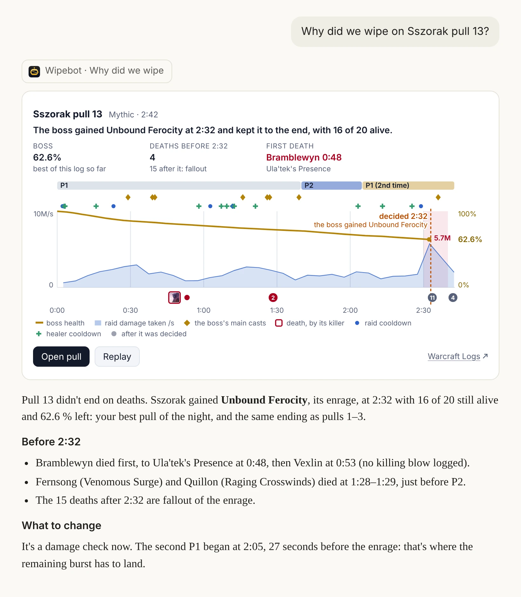
- `Agent` **See a player's pull, and how they cast against the top.** Asking how someone did on a pull shows a card in Claude and ChatGPT: their healing or damage per second alive, their rank and where it stands among the spec's ranked kills (or their parse on a kill), the time they lost, a ribbon of when they cast, sat capped or were dead with their cooldowns on it, and one click compares their casts per minute with top players of their spec. In Discord the same card comes as a picture, with the biggest differences against the top when you ask for that comparison.
- `Agent` **A player's night at a glance.** Asking how someone did over a night on a boss shows a card in Claude and ChatGPT, and a picture in Discord: their healing or damage per second alive pull by pull, where they died and whether it counted (before the wipe was decided), the boss's health left at the end of each pull, the trend in thirds, and their cooldowns summed. Open it for a table of every pull; click one for that pull's own card.

  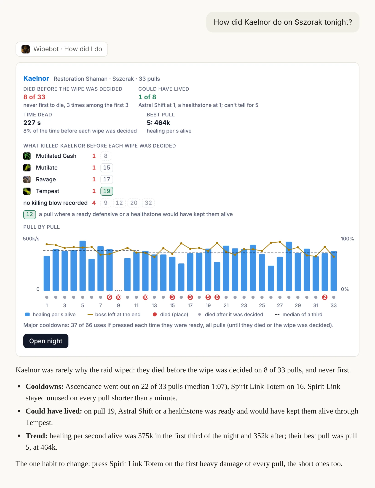
- `Agent` **A kill's card says how fast and how clean it was, and a death a mechanic dealt outright is called that.** The pull card of a kill shows its speed and execution percentiles against other kills of the boss. On a player's night and in the defensives check, a death with no hit logged after high health reads "killed outright" (nothing ready would have stopped it) instead of "can't tell".
- `Agent` **See the raid's night on a boss.** Asking how the night went shows every pull as a bar of the boss's health left, coloured by what ended it, with the night's best so far and the guild's best before the night; then how the pulls ended and what killed each pull's first deaths, ranked. Click a pull for its own card; on a night with several bosses, switch between them. In Discord it comes as two pictures.
- `Agent` **See a death.** Asking what killed someone shows the death drawn, in Claude and ChatGPT and as a picture in Discord: the hits in the 10 seconds before it with their health after each, the healing they got, the killing blow, the defensives they had ready, and who died with them. When a mechanic kills outright, with no hit logged while they were at high health, it says so instead of blaming the healing.
- `Agent` **A player's night says what keeps killing them, and whether they could have lived.** The night card now leads with what killed them before each wipe was decided, most deaths first, with a chip per pull: green where a ready defensive or a healthstone would have kept them alive. Their output and deaths pull by pull follow; in Discord the two come as separate pictures, each readable on a phone.
- `Agent` **The pull and player cards say more at a glance.** Each death on the pull's card shows what killed it, and a line says how the wipe stands against the night's earlier pulls and the guild's best (a new guild best in gold). A player's card lists up to two things that went well and two to fix: a death before the wipe was decided, time without casting, a capped resource, a cooldown left unused, where they rank.
- `Discord` **Click through the pictures.** Under each picture are buttons for the next thing to look at: the pull's first death or a player's card, a player's casts against the top or their night, a pull of the night, and "My night" for your own. Only you see what you open, and it comes with its own buttons, so you can keep going. Buttons on older answers keep working.
- `Discord` **Pictures come whole, one under another.** An answer with several pictures showed them side by side, each cropped to a tile until tapped; now each sits full width under the answer, with a button to its pull on Warcraft Logs, and a gold edge when the pull is a new guild best. A message also holds twice the text, so long answers come in fewer messages.
- `Discord` **The pull as a picture with the answer.** Asking about a pull, and the post after each wipe, come with the same picture of the pull as in Claude and ChatGPT: boss health against the raid's damage taken, phases, the boss's casts and each death.

### Changed

- `Agent` **Boss strategy that keeps up with nerfs.** Asking how a boss works or what to know before a night now comes with Blizzard's hotfixes to that boss that are newer than the guides, so a nerf the guides haven't caught up with (fewer orbs, fewer targets) is in the answer. The guides' Mythic strategy now comes whole, through the last phase, and the ability list shows only the difficulty you raid.

### Fixed

- `Agent` **Whose kick it was, from your raid note.** When casts got through or a mechanic hit the wrong people, the answer could say the log doesn't show whose job it was, even with your raid note saved. Now it knows the guild has a note for that night and checks it, and for kicks whether the note assigns any.
- `Discord` **Notes at the top of a thread.** Asking in a thread now reads the messages it opens with, such as a forum post and the notes posted under it, however old; before, only the last 12 hours were read.

## [0.9.0] - 2026-10-25

### Changed

- `Agent` **Answers keep to what decided your question.** A side story that didn't decide it is left out or offered in a line, and a big question (a whole fight, every raider's job) gets the part you asked for first, with the rest offered.

## [0.8.0] - 2026-10-25

### Added

- `Discord` **Link your own notes in a question.** Ask "how do we do Coiled Altar? <link>" with a link to a message, thread or channel, and the answer goes by what your guild wrote there over the guides. It reads only what you can read yourself, and needs the bot to read channel messages (`WIPEBOT_CHANNEL_CONTEXT=1`).
- `Agent` `Discord` **Who's in for the coming raid nights, from Viserio Cooldowns.** Ask "am I in on Coiled Altar tomorrow?", "who's benched?" or "who's coming Monday?": the answer reads the calendar's sign-ups and the week's setup per boss. An officer connects the group's key once with `/wipebot viserio`.
- `Agent` **A raid plan's scenes come with their links.** An answer about a scene can link it on raidstrats.gg instead of naming its number.
- `Discord` **Raid markers, spec and boss ability icons in answers.** A raid marker shows as its icon, whether the answer quotes a note's {skull} or says "the star marker"; each mention of a raider gets their spec's icon instead of bold; and a boss ability gets the icon you know from your boss mod. Lists of who does what go one raider per line. Answers also mark what was done with ✅ and the thing to fix first with ⚠️.

### Changed

- `Discord` **The line under your question shows what the answer is doing.** What it's reading right now, with the boss and pull ("Reading the raid plan (Coiled Altar)") and a spinner, what it has already looked at with a tick, and how long ago you asked.

### Fixed

- `Discord` **Asking the bot about a boss you haven't pulled yet reads the saved note and plan.** The note saved for tomorrow is given as it is, and the plan shown as drawn, as in Claude, instead of the bot saying it can only read them against a night with pulls.
- `Agent` **A note for a boss not pulled yet names its cooldowns,** so each spell in the answer reads and links like the others.

## [0.7.0] - 2026-10-25

### Added

- `Agent` **Ask about the guild's raid plan, with no pull to check it against.** "What's our plan for Coiled Altar?", "Where do I stand in P2?" or "Who takes the orbs?" is answered from the plan as drawn on raidstrats.gg, scene by scene: each spot by the boss and the raid markers, what each number does from the plan's side panel, the notes, and what's drawn around them. A plan exported from Viserio with the night's names filled in answers for each raider by name.

### Fixed

- `Agent` **Asking about a boss you haven't pulled yet works.** The plan is shown as drawn and the newest saved note as it is, instead of an error saying the night has no such boss.
- `Agent` **A raid plan missing because the guild's raidstrats.gg login stopped working now says so.** Instead of "none saved", the answer says the plans can't be fetched and an officer has to connect again.
- `MCP` **No more empty replay box.** Questions about the raid plan answer in text, and the pull's replay with the plan's spots opens when you ask to see a pull against the plan. Over a whole night, the box shows the answer's map instead of nothing.

## [0.6.0] - 2026-10-24

### Changed

- `Discord` **Posts after a wipe come sooner.** A post starts from the pull, and the guides on what ended it, already looked up, so a typical one arrives about seven seconds sooner and the slowest about fifteen.

## [0.5.3] - 2026-10-24

### Fixed

- `Agent` **A late taunt is no longer read as no missed taunt.** The tank swaps now name a swap debuff that stacked past one while a tank held the boss, and when the other tank took it over, so "did I miss a taunt?" gets the late swap the log shows, still without calling it one tank's fault.

## [0.5.2] - 2026-10-23

### Fixed

- `MCP` **ChatGPT no longer counts the replay viewer as a write.** The two tools only the pull replay calls were listed under Write in ChatGPT, beside saving a raid note, as tools that may change something; they only read.

## [0.5.1] - 2026-10-23

### Fixed

- `MCP` **The plugin's connector in Codex.** Installed from its marketplace in Codex, also inside the ChatGPT desktop app, the plugin brought only the method for reading raid logs, without the connector to sign in to; it now brings both. ChatGPT's chats take the connector on its own.

## [0.5.0] - 2026-10-23

### Added

- `MCP` **The plugin in Codex and ChatGPT.** The same plugin, the connector with the method for reading raid logs, now also installs in Codex and the ChatGPT desktop app: `codex plugin marketplace add` with the plugin's repository, then install it from the Plugins directory and sign in with Warcraft Logs.

## [0.4.0] - 2026-10-23

### Added

- `Discord` **What Wipebot is looking at.** When an answer takes a while, a small line under your question shows which parts of the log Wipebot has read so far. It goes away when the answer is posted, and you're notified of the answer, not of the line.
- `Agent` **A realistic target against the top players.** Asked what the top players of a spec do on a boss, Wipebot now also says where the spec's kills spread (the 90th, 75th, 50th and 25th percentile), so you have a level to aim at rather than the single best parse. For a healer, it shows how many healers each top log had and how much of their healing the top healer did, next to your own raid's, since a healer's numbers depend on the healers around them.
- `MCP` **A public copy for any guild.** Wipebot now also runs at [wipebot.enfo.dev](https://wipebot.enfo.dev) for anyone with a Warcraft Logs account, free and best effort: in Claude, add the marketplace `Enf0/wipebot-plugin`; elsewhere, add `https://wipebot.enfo.dev/mcp` as a connector. It shares one Warcraft Logs allowance, so each user gets part of it per hour, and questions that need new data can wait for the next hour.

### Changed

- `MCP` Someone who is no longer signed in to Wipebot from any app is forgotten 90 days later: their Warcraft Logs name and characters are deleted.

### Fixed

- `Discord` A text chart in an answer no longer shows spell links as raw markdown inside it.

## [0.3.0] - 2026-10-23

### Added

- `MCP` `Discord` **A raid note pasted late.** Forgot to paste the note before the raid? Paste it afterwards with the pull it was used from, such as "from pull 7", and that pull and the later ones are checked against it, while the earlier ones keep that night's note saved before, if there was one.
- `Agent` **When the kick order changed.** Checking the night's kicks against a note that only fits the later pulls, Wipebot says from which pull it fits and who had the slots before, and counts the kicks from there, so no one is blamed for a slot that wasn't theirs yet. Tanks covering someone's kick are read as backup, not as another order.
- `Agent` **Holy Power lost at the cap.** Asked how a Holy Paladin or Preservation Evoker did, Wipebot now looks at their Holy Power or Essence as well as their mana: how long it sat full, how much was lost there and from which spells, on a pull and over the night, and how long the top players of the spec sit full on the same boss.
- `Agent` **Whose kick lost the pull.** Over a night, Wipebot counts per player whose cast went through first on each pull lost to kicks, since the casts after it come too late to matter, and lists every such pull.

### Changed

- `Agent` Advice on how to play your spec, such as what to cast or spend and when, now follows its class guides: Wipebot reads the spec's guide before telling you what to change.
- `Agent` The first "how did I do tonight?" about a night now answers about 20 seconds sooner: a player's night of 40 pulls is read in a few requests instead of eighty one after another.
- `MCP` `Discord` A saved raid note now counts only for the raid night it was pasted for, since the note changes each night with who comes: a night nothing was pasted for asks for the note instead of using another night's.
- `Agent` A kick on someone's cast that another player took, such as a tank backing up, now counts as covered instead of missed: the cast was handled. Who missed most is now whose casts went through, and the pulls lost within seconds of kicks going through are named, with which assignments they were.

### Fixed

- `Agent` Who had a kick ready when a cast went through now counts every spell a player kicked with that night, so a player with a second interrupt on hand is no longer read as having none.
- `MCP` `Discord` A raid note changed during a raid no longer carries over to the next raid night: the night's pulls before a note pasted late used the last night's note instead of that night's.
- `Agent` Asked who got caught by a mechanic that only puts a debuff on players, such as a wave that stacks one, Wipebot now ranks them by how often it caught them instead of by the little damage it dealt.

## [0.2.0] - 2026-10-22

### Added

- `Agent` **Week over week.** Ask whether the raid is doing better on a boss than last week, and Wipebot goes through each of the guild's raid nights on it: the pulls, the kill, the best wipe and what ended the pulls, night by night.
- `Agent` **Pulls by name.** Ask about the kill, the best wipe, the last wipe, or the first or last pull of a boss, and Wipebot finds it without looking up its number first.
- `Agent` **One stretch of a pull.** Who got hit by a mechanic can be counted for one stretch of each pull, such as the first set of orbs, without the rest of the pull mixing in.
- `Discord` **Answers in your DMs.** Ask Wipebot in a channel to send something to your DMs, such as who missed their kicks, and it answers there as if you'd asked there, where it may name players. It only ever writes to the one who asked.
- `MCP` **The raid plan in the replay.** In Claude, checking a pull against the raid plan opens the pull's replay with the plan's spots on it: a button for each time its mechanic happened, and at each, a red ring and a line from the spot of every player who stood off theirs.

### Changed

- `MCP` In Claude, the plugin's method now loads before Wipebot's first tool call on any raid question; smaller models such as Haiku had skipped it on most questions.
- `Agent` A question that assumes its answer, such as "do we need more DPS?", now gets that checked first: the answer opens with what the log shows lost the pull. Asked what to change, Wipebot says whether to keep the plan or change it, which damage spike needs a healing cooldown, and whether more damage or another healer would help at all.
- `Agent` Why a pull wiped now says whether it ended the way earlier pulls that night did, or got past the thing that ended most of them.
- `Agent` How the night went now counts the pulls by what ended each, so the one thing that ends most of them stands out; why a pull wiped says plainly when it wasn't the boss's enrage or a damage check; and who was hit, stood where or had a kick ready comes with a reminder that whose job it was isn't in the log.
- `Agent` Why a pull wiped now names the deaths that led into the moment that lost it, counts an ability that kills in pulses over a few seconds (a set of hits, a wave of adds) as one moment, and no longer starts a run of deaths at a player who was battle-ressed.
- `Agent` Asking about the adds over the whole night now also gives, for the most damaged kinds, when each wave of them died and each player's damage on them over the pulls.
- `Agent` Where everyone stood at a moment now also gives each player's distance to the player you ask about, such as the one carrying a mark the raid stacks on, so who was in range is measured rather than guessed from where they stood around the boss.

### Fixed

- `Agent` A late taunt is no longer called one tank's fault: the log shows who taunted when, not whose turn it was. Asked what stats to aim for, Wipebot gives the spec guide's priority and treats what the top players wear as a note beside it, not a new priority.
- `Agent` Comparing your talents with the top players says which part of the tree each is in (class, spec or hero), so it no longer suggests swapping a class talent for a spec talent.
- `Discord` In a DM, Wipebot knows you by your nickname in the guild's server, so a character named there is found without asking.
- `Agent` When Warcraft Logs is down, questions about a raid night Wipebot has already read are still answered from what it kept, instead of failing on the first step.
- `Agent` Comparing your talents with the top players no longer lists a spell with two versions on one choice node (such as Earthquake, Blizzard or Rain of Fire) as a talent you lack: Wipebot says you took the other version, and how the two differ.
- `Agent` Asked about the whole night while the next pull is under way, defensives, healing, damage and healing breakdowns, the adds, and checks against the raid note or plan no longer count that unfinished pull: they leave it out and say so, as the other answers about the night already did.
- `Agent` Asking whether a boss has an enrage now finds what the guides say about it, whether they call it an enrage or a berserk.

## [0.1.0] - 2026-10-21

### Added

- `Agent` `MCP` `Discord` **Wipebot is open source.** Any guild can run its own copy, under the GNU AGPL v3.0: the connector its members add to Claude, ChatGPT or another assistant, and the Discord bot. How to set it up: docs/setup.md.

## [0.0.11] - 2026-10-21

### Added

- `MCP` **Save the raid note or plan from Claude or ChatGPT.** An officer (by default the Guild Master and Officer ranks in the guild) pastes the note exported from Viserio, or the plan's export from raidstrats.gg, and asks Wipebot to save it for the guild. From then on, everyone's answers in Claude, ChatGPT and Discord check pulls against it without a paste. Anyone else's paste is used for that answer only.
- `Discord` **Officers save the raid note or plan by pasting it.** An admin sets the officers' role with `/wipebot setup officers:`; until one is set, the members who can manage the server are the officers. Officers also change or stop the posts after wipes someone else asked for in a channel. `/wipebot note` is gone: an officer pastes the note or plan in a message to Wipebot instead (Discord's file for a long paste works too), and `/wipebot settings` now lists what's saved.
- `Discord` **Names in the channels you choose.** An admin turns naming players on or off in any channel with `/wipebot names`: there, and in its threads, Wipebot says who made the costly mistakes, as in a DM. It replaces the officers' channel in `/wipebot setup`, and names stay on where that was.
- `Agent` **The adds over the whole night.** Ask how the adds went on a boss across the night and see how many of each came and died over the pulls, the damage they took, their casts and who kicked them, and each pull in a line. When the log records no deaths for an add, Wipebot says it can't show the order they were killed in.

### Changed

- `Agent` Questions about defensives and raid cooldowns are answered a few seconds sooner the first time they're asked about a night.
- `Agent` When the hour's Warcraft Logs allowance is nearly used up, the few questions that read many nights or pulls at once (the tanks' taunts over the weeks, attendance, the healing over a night, what a raider keeps dying to over the weeks) are left for later, with a note saying in how many minutes to ask again, so the other questions still get answers.
- `MCP` Signing in from Claude or ChatGPT now shows which app is asking and where you go back to once you're signed in, before the Warcraft Logs login: one click goes on. A sign-in finishes only in the browser it was started in.
- `Agent` Damage, healing, damage taken and casts over a pull or a night now stop where each wipe was decided, as Wipebot's other answers do, so what happened after the boss's enrage doesn't swamp the cause. Ask for the whole pull to include it.
- `Agent` Checking soaks against the raid note, a player hit by almost none of their group's soaks is named as likely not soaking with that group, such as a reserve or someone moved since the note was written, rather than only counted as missing them all.

### Fixed

- `MCP` A moment's hiccup at Warcraft Logs no longer signs you out of Wipebot in Claude or ChatGPT.
- `Agent` A boss named as one word, such as "twinfangs", is now found in questions about the night's logs, as it already was in the guides.
- `MCP` Where several guilds share one Wipebot, asking in Claude or ChatGPT about "our last raid" now means your own guild's. It used to be the first guild's for everyone.
- `Discord` A question asked while Wipebot was still writing a post after a wipe for you is answered even when that post takes too long or fails. It used to get "Something went wrong" as well. An answer under way when the next raid night's log starts now finishes, and when the logs take over a minute to load, Wipebot says so instead of waiting on.
- `Discord` When many raiders get their feedback after the same wipe, every answer now finishes. With more than six answers at once, one used to stop halfway with "Something went wrong". And after an answer failed, asking again starts afresh instead of failing the same way.
- `Agent` Rankings, attendance, a raider's logs and guides are no longer weeks old in the first answer after a quiet spell. That answer used to show what Wipebot had last read, however long ago, and only the next one was up to date.
- `Agent` `Discord` During a raid, a pull that ended while Wipebot was reading it now shows in full in later answers. Its deaths and numbers used to stop where the pull was when Wipebot first read it.
- `Agent` When Warcraft Logs stops answering for a moment during a raid, questions about the night are answered from what Wipebot read of the log seconds before. They used to fail.
- `Agent` After a patch, the spec cooldowns, talents and spell names Wipebot counts with are up to date within a day. They used to stay as they were until Wipebot restarted.
- `Agent` A shaman back from Reincarnation, or anyone else who comes back to life by themselves, now counts as alive again, as after a battle res: in the players alive after each death, when half the raid was dead, and whether they could have cast a planned cooldown or kick. They used to count as dead until they died again.
- `Agent` A Demon Hunter who dies stays dead in their time alive, time lost and cooldowns ready again until something brings them back. A cast Warcraft Logs adds by itself a second after the death used to count them alive for the rest of the pull.
- `Agent` Who took far more of a boss's damage than the rest now counts the time a player was alive again after a battle res. A player brought back early used to look as if they'd stood in everything.
- `Agent` Who had a kick ready when an add's cast went through now includes players brought back by a battle res. Once they had died, they used to be left out for the rest of the pull.
- `Agent` A cooldown that came back only after the wipe was decided is no longer called ready again and unused on a raider's pull: by then no use was missed.
- `Agent` When Warcraft Logs answers only part of a question about a night's pulls, Wipebot says so and to ask again. It used to fail with an unexpected error.
- `Discord` When Warcraft Logs isn't answering, Wipebot now says so and asks you to try again in a few minutes. It used to say nothing at all.
- `Discord` A post after a wipe no longer gives up while Wipebot is still answering your last question, and after a restart in the middle of the raid it posts about the latest wipe only, not about every wipe it missed. A question also no longer waits while Wipebot starts a conversation with someone else.
- `Agent` "Was Bloodlust up when I pressed my cooldown?" now finds it whichever kind the raid had, such as Time Warp or Primal Rage, and a buff someone else gave you, such as Power Infusion, now shows at your casts too. Wipebot used to see only the buffs you gave yourself.
- `Agent` Asked how a boss works on Normal, Wipebot now reads the guides' Heroic strategy. It used to read the Mythic one.
- `Agent` Where a player's damage or healing on a wipe stands among their spec's kills is measured against every ranked kill again. Early in a patch it could count only the best 100, so the same player read as below the 25th percentile one time and above the 75th the next.
- `Agent` One hit that kills ten players in a second is no longer split into deaths that count and "fallout" a few milliseconds later: when half the raid dies at once, every death of that moment counts, and the deaths in the seconds after it are fallout. Half the raid dead now means half, with a battle res counted, and a buff a council boss gains when its partner dies is no longer read as the moment the wipe was decided, nor as how the wipe ended or a reason to leave later deaths out of what killed the first players.
- `Agent` What killed players in each pull's post counts only the deaths until the wipe was decided, so an enrage's fallout no longer tops the list, and no killer drops off the end. A pull still going reads as in progress, not as a wipe or a new best, the latest finished pull is the one meant when no pull is named, and a raider's night, who took most of each mechanic over the night and a raider's deaths over the weeks leave it out until it ends.
- `Agent` Players alive after each death count a battle res, and many dying at once with no killing blow in the log reads as one moment that killed many, not as deaths one after another.
- `Agent` An ability the log records under several ids, such as Virulence, is counted once: a death after hits of both no longer counts twice, and the night's killer, who took most of a mechanic and the abilities behind a damage spike each show it as one. How many hits landed within a second of each other now says, right beside the count, that the log can't tell one hit from two.
- `Agent` A player's cooldown uses against possible uses count only until they died or the wipe was decided, so time dead and the fallout no longer add uses they could never have pressed. A night's count above what the base cooldown allows, such as 2/1, now says a talent or effect shortens it, as one pull's count did.
- `Agent` A player's casting gaps are no longer excused as a raid-wide pause because most of the raid was dead: a pause is when most of the living stopped casting.
- `Agent` A wipe compared with a kill now says how far behind the kill's pace the pull was and since when, whether the kill was over before the boss's enrage, and how many had died on each side by then, so a wipe lost to deaths no longer reads as a damage check. The side-by-side table is shorter.

## [0.0.10] - 2026-10-19

### Added

- `Agent` **Who didn't kick as assigned?** A kick order in the raid note, such as "Kick #1 left" called to one player as an add starts its cast, is now checked against the log: who kicked each cast, who didn't, and which casts went through, for a pull or the whole night. Whichever side's add starts casting first, each cast is put on the right player.
- `Discord` `MCP` **Raid plans fetched from raidstrats.gg.** An officer connects their raidstrats.gg login once with `/wipebot raidstrats`, and nobody pastes plans any more: whenever an answer needs a plan, Wipebot fetches the guild's plans, in Discord and in Claude and ChatGPT alike, and keeps a new version when one changed.

### Fixed

- `Agent` Asked about casts that went through, Wipebot now names the players who never kicked on the boss that night. It used to give only their number, and could name the wrong ones.
- `Agent` A boss pulled after a long break in the raid, such as the next boss after dinner, now shows up in Wipebot's answers. After a break of 20 minutes or more, Wipebot used to stop reading the night's log, and said the boss wasn't in it.
- `Discord` `MCP` Asked about the raid plan, Wipebot now says it fetched the plans from raidstrats.gg, as which account and when, and that a newer version was saved since the pulls were planned. Ask it to check against the newest version and it checks every pull against that one. It used to show only the version each pull was planned with, and said no raidstrats.gg login was connected when one was.
- `Discord` Answers in Discord are easier to skim: they open with one short bold line, a player's name is bold only the first time it comes up, and the fix for the next pull comes first instead of last.
- `Discord` `MCP` A raid plan pasted to Wipebot stays the one it uses until the plan changes on raidstrats.gg. The next fetch used to replace it with the plan as last saved there, which leaves out a roster given only in the planner's link.

## [0.0.9] - 2026-10-18

### Fixed

- `Agent` Casts per spell, yours and the top players', now count spells Warcraft Logs files under another one, such as Infernal Bolt under Shadow Bolt, Void Blast under Mind Blast or Fatebound Coin under Hand of Fate. They used to be missing, or shown as not counted.

## [0.0.8] - 2026-10-17

### Added

- `MCP` **The saved raid note and plan in Claude and ChatGPT.** "Did people do their jobs?" and "was everyone on their spot?" no longer need a paste: Wipebot checks your guild's pulls against the note and plan your officers saved in Discord.
- `Agent` **Where do I want my cooldowns?** Ask what the top players of a spec do on a boss and see when the top five pressed their major cooldowns, beside the boss's casts, and how many of the top 50 use each.
- `Agent` **Did the healers keep up?** Ask about a pull or the whole night and see when the raid took the most damage, which abilities it came from, how much healing went into it, each healer's healing and overhealing in those seconds, and which healing cooldowns were used or still ready. Over a night, the spikes that came back pull after pull are grouped, so you can see which one gets no cooldowns.

### Changed

- `MCP` **Sign in with Warcraft Logs.** Connecting Wipebot in Claude or ChatGPT now asks for your Warcraft Logs account instead of Battle.net, and knows your characters from the ones you claimed there. Claim your main on warcraftlogs.com first. If you're already connected, you'll be asked to sign in once more.
- `Agent` What killed a player now also says what each healer was casting in the last five seconds, and on whom.
- `Agent` "Would a defensive have saved them?" now has an answer for Exhilaration, Survival of the Fittest, Desperate Prayer, Ice Barrier, Blazing Barrier and Rallying Cry, where it used to say it couldn't tell.
- `Agent` Casts by player show how many a minute, so players on pulls of different lengths compare directly.
- `Agent` Wipebot refers to players by their character's name, never guessing "he" or "she".

### Fixed

- `Agent` A raid-wide stun or knockback no longer counts as your casting gap: stretches when most of the raid cast nothing are left out, and named.

- `Agent` A player brought back by a battle res counts as alive again: checks of the raid note's callouts and of who should have taken a mechanic no longer call them dead for the rest of the pull.
- `Agent` A pull's timeline says the boss's health it ended at, and the wipe's percentage beside it when the two differ (Warcraft Logs weighs phases into the wipe's), so 8.95% and 6.4% for the same pull no longer look like a contradiction.

## [0.0.7] - 2026-10-16

### Added

- `Agent` **Am I getting better?** How you did over a night now ends with your trend: deaths before each wipe was decided and your damage or healing per second alive, over the first, middle and last third of the pulls.

### Changed

- `Agent` How you did on a pull now shows when the boss cast its main abilities (Imbibe on Vashnik) beside your cooldowns, so a raid cooldown held for the damage isn't read as a late one.
- `Agent` **Who pulled?** A pull where one player hit the boss and nobody else followed is now called out, and pulls the raid reset are marked.

### Fixed

- `Agent` The pull timeline shows the boss's casts in the second they happened; they could show a second early.
- `Agent` Reading a page of a class guide that an earlier answer linked works for Wowhead and Icy Veins pages too; it could fail with an error.
- `Agent` Raid prep says how many players lack each consumable, not only who.
- `Agent` Adds that the log splits over two units (Vashnik's Malignant Totems) no longer show more deaths than came.
- `Agent` A buff both bosses gain at the end (the Coiled Altar's Soulbound) is listed once.
- `Agent` An add's cast whose start the log puts on another unit (a Drowned Echo's Soulcoiler's Curse) is counted as one cast that went through, as Warcraft Logs counts it, so the kick counts agree wherever you ask.
- `Agent` A channelled cooldown such as Divine Hymn counts once per use, not once per tick.
- `Agent` Whether a defensive would have saved you no longer counts on Cloak of Shadows lasting its full 5 seconds: its immunity is sure only for a moment.

## [0.0.6] - 2026-10-15

### Added

- `MCP` `Discord` **One Wipebot.** Wipebot in Claude and ChatGPT and in Discord are one now, with one name wherever you ask. Nothing to re-add: a connector you added before keeps working.
- `Discord` **Raid plans from raidstrats.gg.** An officer pastes the plan's export (the planner's Export button) to Wipebot, or attaches it to `/wipebot note`, and answers check where everyone stood against their spot: who was off it, by how far, and whose spot they took. A map shows the plan laid over where the raid stood, with a line from each missed spot to its player, or one player at every spread of the night. Paste it again after a change during the raid, and earlier pulls keep the version they were planned with.
- `Agent` **Where did we stand when it went off?** Ask where everyone stood when a mechanic happened, on any boss: each time a debuff ran out, the boss cast it or it hit, see who had it, who was hit by someone else's and how far apart they stood, on one pull or over the night, with a map of where you stood each time. In Claude and ChatGPT, paste the plan's export to check positions against it too.
- `Agent` **Your stats on the pull.** Asking how you did or how your build compares shows the crit, haste, mastery and versatility your gear gave you on that pull, straight from the log, so two players of the same spec can be compared stat by stat.
- `Agent` **Anything else in Warcraft Logs.** For a question no other answer covers, such as kills around your own item level rather than the fastest, the players in one fight of another guild's log, or events of one kind, Wipebot can now ask Warcraft Logs directly. Such answers take a little longer.
- `Agent` **Any guide or news page.** Wipebot can search Wowhead, Method, Icy Veins and Warcraft Wiki and read any of their pages in full, so a question no other answer covers, such as the rest of a news post, a guide's other pages or a wiki article, is looked up rather than turned down.
- `Agent` **Is it a 4-heal fight?** Ask what the top raids bring to a boss and see how many tanks, healers, melee and ranged the 50 fastest kills had, how fast each setup killed it, and links to the fastest kills.
- `Agent` **Who pulled?** Ask who keeps pulling the boss early and get who hit the boss first on each pull, with what, how far ahead of everyone else, and a count over the night. The log has no pull timer, so it shows who opens and who goes on their own, not how early against the countdown.

### Changed

- `Agent` **Who played well on the kill?** Damage and healing by player on a kill now show each player's spec and parse, so players of different specs are compared by how they did for their spec, not by raw numbers.
- `Discord` Posts after each wipe are a few short lines you can read before the next pull: how it ended, what decided it, and what to do next.
- `Agent` Comparing your build with the top players names the enchants they use on each slot where yours is missing or different, so "which enchant should I take?" is answered from the logs.
- `Agent` **Did people press what the note called for?** Callouts in the raid note, like "Big Personals" to everyone or a job for one player, are now checked against each pull: who pressed a defensive, raid cooldown or other spell around the call, and who had one ready and pressed nothing.
- `Agent` Asking how hard a spell hits shows its hits, average hit and crit rate per player, so "why does their Starsurge hit harder than mine?" gets numbers.
- `Agent` Asking about tank swaps shows when each tank used their taunt and when it was ready again, so "was the taunt on cooldown?" is answered from the log.
- `Agent` **The raid note over the whole night.** Ask "who missed their soak most?" or "who pressed personals when the note said?" and get each player counted over every pull on the boss, in seconds rather than a minute: soaks of their group they missed while alive, each planned cooldown on time, early, late or not cast, and how often they pressed something at each callout.
- `Agent` **When do your cooldowns go out?** How you did over the night now shows when you used each major cooldown on every pull, and when the first one usually went out, so "when does my first Arcane Surge go out?" gets the times and the outliers in one answer. Whether a buff was up when you cast a spell can be asked over every pull too.
- `Agent` **Your stats against the top players.** Comparing your build with the top players now shows their crit, haste, mastery and versatility from their own logs next to yours, as shares of the total, so "how do my stats compare with the top?" gets numbers rather than only the guide's stat priority.

- `Agent` **Was it the mechanics?** Comparing how you play with the top players now shows how much of the time your energy, rage or other resource sat full next to how much theirs did on the same boss, so "I was capped because of the mechanics" can be checked: they meet the same fight.
- `Agent` **Who took the bait?** Asking who took a mechanic meant for one player, such as a mark the furthest player gets, lists each time someone else got it over the night: the pull, when, how long they kept it and whether the player it was meant for was still alive. It answers in seconds rather than going through the night pull by pull.

### Fixed

- `Agent` A kill no longer reads as the boss left at 0.01%, which made a clean kill sound like a near miss.
- `Agent` On a fight with several bosses, a buff each of them gains, like the Entombed Sentinels' enrage, is counted once per pull rather than once per boss.
- `Agent` Checking a raid note against a pull that ended early, or against a kill shorter than the note, now still lists the cooldowns planned after that point, so a review of the note covers all of it instead of saying the rest can't be seen.
- `Agent` Adds the log records under two ids, such as some boss totems, are counted whole: how many died and how many were still up at the end no longer misses about half of them.
- `MCP` Claude and ChatGPT ask you to sign in to Wipebot again less often: a hiccup while they renew the connection no longer signs you out.
- `Agent` Dispel counts add up: each debuff applied was either dispelled or ran out, and a dispel that only took a stack off is counted apart. Before, the dispelled and ran-out counts could add up to more than were applied.
- `Agent` A Restoration Shaman's healing by spell shows the health Spirit Link Totem took from healthier players on a line of its own, out of the total and the shares; before, it was a negative row that lowered them.
- `Agent` Asking for your guild's other raid nights finds them without your server and region; before, the answer could stop to ask for them.
- `Discord` On a night with a single-boss raid as well as the tier's, Wipebot knows which raid each boss is in, so "the first boss" is the raid's first and the answer says which boss it took; before, a boss from the other raid pulled first could be taken for it.
- `Agent` A boss named any way ("Twinfangs", "Twin Fangs") finds its guides, all three of them; before, a name spelled differently from the guide sites could miss Method's guide or every guide.
- `Agent` Asking about a boss's hotfixes finds every one of Blizzard's changes since the raid opened; before, only Blizzard's newest hotfix post was read, so changes from before the latest patch were missed.
- `Agent` Asking about a boss's nerfs finds Wowhead's post about them and reads it; before, another boss with a similar name could hide it, and only the newest post about the boss was read.
- `Agent` When a guide site or Warcraft Logs can't answer, the part of the answer that needs it says it's unavailable and the rest still comes; before, it could read as no defensives, no cooldowns or not ranked, or fail the whole answer.
- `Agent` A defensive or raid cooldown cast as the talent that replaces it (Crusade for Avenging Wrath, the other Divine Protection) counts as used in a death's breakdown, the night's defensives and the raid note's callouts; before, it could read as never pressed.
- `Agent` Abilities are found by name the same way in every question: capitals and accents don't matter, and a name the log doesn't have gets the closest ones it does.
- `Discord` Posts after each wipe keep coming when Wipebot restarts during the raid; before, a restart ended them until someone asked again.
- `Agent` A wipe is called a new best only when it beats the guild's earlier nights on that boss too, not just tonight's pulls; the answer says where the guild got before, with a link to that pull.
- `Agent` A cooldown in the raid note that nobody has cast yet that night shows by its name, not as a spell number.
- `Agent` Spell descriptions include what applies to one spec only, so Death Grip shows as a taunt for Blood Death Knights.
- `Agent` Hit counts for an ability that has several versions in the log, like Raging Crosswinds on Sszorak, count all of them, not only the first.
- `Agent` A cooldown used before the pull, like Stormkeeper, counts as used when your cooldown use is checked; before, it looked like a missed use.

## [0.0.5] - 2026-10-14

### Added

- `Discord` **Posts after each wipe, wherever you ask.** Ask Wipebot in any channel or a DM to keep you posted during the raid, with whatever you want to hear after each wipe of the live log, like who died first and why or what to fix on the next pull. You can ask before the raid starts logging: the posts start with the first wipe. Anyone can ask it to stop.
- `Discord` **An officer channel.** Server admins can mark a channel only officers see in `/wipebot setup`. There Wipebot names players and says plainly who made the costly mistakes, in answers and in the posts after each wipe.
- `Agent` **What do I keep dying to?** Ask what you keep dying to, or what to work on this week, and get your early deaths on each of the guild's raid nights in recent weeks: how often you died before the wipe was decided, how often first, and the abilities that come back night after night.
- `Agent` **Deaths with no killing blow.** When the log names nothing that killed someone, the death's details now say where they were last seen and how far they had just moved, so being thrown or knocked off the platform shows.
- `Agent` **Did anyone have a kick ready?** For each add cast that got through, the answer can say who was alive with their interrupt off cooldown when it began, from the interrupts each player used on that boss.
- `Agent` **What top players play on a boss, before you've pulled it.** Ask what the top Balance Druids (or any spec) play on a boss and get what the best Warcraft Logs parses take: hero tree, the talents where they differ, how the guides' builds compare, trinkets, item level and kill time, links to the top logs and an import string to paste. It works for a boss your guild hasn't pulled yet, as soon as the first kills are ranked.

### Changed

- `Agent` Asking about tank swaps also shows which spells each tank has taken a boss with on the guild's recent raid nights, so whether a spell like Death Grip works as a taunt is answered from your own logs.
- `Discord` Player names in answers are in bold, so you can find who's mentioned at a glance.
- `Agent` Asking why a pull wiped starts from how it ended: one ability killing many at once, the boss's enrage, or deaths one after another, with when each came. A night's review names what killed the raid most, how often it was the first death, whom it killed and who took most of its hits.
- `Agent` Asking how you did or why your damage is low weighs your biggest losses against each other: time dead before the wipe was decided, time without casting and time at your resource's cap, so the answer leads with what cost you most.
- `MCP` In Claude and ChatGPT, each Wipebot tool says which questions it answers and how to read what it returns, and every tool has a readable name.

### Fixed

- `Agent` Asking how you did on a kill right after it no longer fails while Warcraft Logs hasn't ranked the kill yet; your parse shows once it has.
- `Discord` Answers about an earlier night, asked while another report is current, link their spells to Wowhead again.
- `MCP` ChatGPT no longer asks you to approve each Wipebot lookup: they only read your logs and the guides.
- `Discord` A talent named in an answer no longer gets a Wowhead link to a shorter spell inside its name ("Lycara's Inspiration" linked as "Inspiration").
- `MCP` The setup page's steps for ChatGPT match its current menus, and the server address has a copy button.

## [0.0.4] - 2026-10-13

### Added

- `Agent` **Boss loot, and what's in it for you.** Ask what a boss drops or whether there's anything good for your spec: each item's slot, stats and effect, the item level per difficulty, and which drops your spec's best-in-slot lists and trinket advice name.
- `Agent` `Discord` **Did everyone do their job?** Officers save the raid's assignment and cooldown note (the one exported from Viserio) with `/wipebot note`, or by pasting it to the bot. Then ask who missed their soak or whether the cooldowns went out on time. Each soak is checked against its group (who wasn't in it, alive or dead, and who was in the wrong one), and each planned cooldown against when it was really pressed. In Claude or ChatGPT, paste the note into the chat.
- `Agent` **Where do we stand among other guilds?** Ask how the guild compares to the guilds just above and below it on the realm, in the region or worldwide: each one's progress and, for the boss you're on, how many pulls they needed and their best pull.
- `Agent` **Adds' casts, and who kicked them.** The timeline and the adds tool show each add's casts with a cast bar, whether each was kicked (by whom) or went through, and when: "Broodling of Ithraz casts Visceral Burst x15: 8 kicked, 5 went through". Interrupts can be asked per player (who kicked how many) and per pull.
- `Agent` A stacking debuff reaching its highest stacks shows in the timeline ("Eternal Venom reaches 9 stacks on X"), and the boss casts that Lorrgs tracks for the fight are marked, to line pulls up by.
- `Agent` `MCP` Finding reports lists each boss with its pulls and kills, and can be narrowed to the reports a character is in.
- `Agent` **Would a defensive have saved me?** Looking at a death, Wipebot works out whether a personal defensive that was ready, or a healthstone, would have kept you alive through the hits that killed you. When several players died at once, it says which raid cooldowns were ready and whether the raid was stacked close enough for them.
- `Agent` **Everyone's healthstones and defensives.** Ask who used their healthstone, potions and personal defensives on a boss and you get the whole raid in one answer: uses per player, and at how many deaths a defensive was ready but unused.
- `Agent` **Buffs at your casts.** Ask whether a buff, or how many of its stacks, was up each time you cast a spell, like Starlord at your Starsurges.
- `MCP` **Wipebot in Claude and ChatGPT.** Add Wipebot as a connector and sign in with Battle.net to ask the same questions as in Discord, in your own chats. It's open to members of the guild.
- `MCP` **Wipebot knows which characters are yours.** Your Battle.net sign-in tells it which characters are yours, so "how did I do?" works without giving a name. Questions about reports start with the guild's own logs.
- `MCP` **Replay a pull.** In Claude, asking where everyone was during a pull opens a replay you can play, pause and scrub at different speeds. Everyone moves in their class colour, and you can see the boss and which way it faced. Each death and the moment the wipe was decided are marked on the timeline. Hover over a player to see their spec and their distance to the boss.
- `Discord` **Wipebot remembers you.** Once it knows which character you play, "how did I do?" works in every later chat without naming it. Ask it to keep a preference ("answer in English", "don't compare me with others by name") and it sticks to it from then on. Ask what it remembers about you, or tell it to forget, at any time.
- `Agent` `Discord` **Pull maps.** Ask "where was everyone when they died?" and you get the boss room at that moment. Every player is shown in their class colour, the dead where they fell, and which way the boss and each player faced. Everyone is named, and the players you asked about stand out.

### Changed

- `Discord` Items named in an answer link to their Wowhead page, the way abilities already do.
- `Agent` **Downtime and dropped casts.** "How did I do?" now shows the stretches where you cast nothing (when, and for how long) and the casts you began and dropped, each with its time, so you can check what was going on then. Next to the top parses, you see how much of their time was downtime and how often they dropped a cast, so movement the fight forces isn't held against you.
- `Agent` **Boss guides from three sources.** Method, Wowhead's cheat sheet and Icy Veins, and every boss of the raid is found (The Twin Fangs, Vashnik, the Coiled Altar, Kith'ix and others were missing Icy Veins' page). When one site has no Mythic guide, the answer says so and uses what it has.
- `Agent` Asking about a spec's rotation, cooldowns, defensives or talents gets the raiding sections of the guide (not the leveling or Mythic+ ones), longer, and with the date each page was last updated.
- `Agent` Hotfix questions also report Wowhead's news about the boss or spec when Blizzard's running hotfix post hasn't caught up with the weekly reset's tuning.
- `Agent` Interrupts and dispels add up: began, kicked (or dispelled), went through (or ran out), ended otherwise; a debuff hardly anyone dispels is marked as such, and dispels say on whom they ran out.
- `Agent` Adds that leave without dying (despawned, transformed, gone with the kill) are no longer called "alive at the end"; a boss-type add that comes several times (the Drowned Echoes) is listed with the adds.
- `Agent` One cast landing on several groups reads "Feasted on 6, then 6, then 7 players"; two abilities sharing a name read "Mutilate (2 abilities)", not "x2".
- `Agent` A pull number without a boss, on a night with several bosses, picks the boss that has it or asks which, instead of failing on the wrong boss.
- `Agent` **A player's resource is the one their spec spends.** Maelstrom, Essence, Holy Power and the rest are judged for capping; mana only for healers (an Elemental Shaman no longer gets "mana 100%").
- `Agent` A cooldown Lorrgs lists without a length (Elemental Ascendance) is still listed with its cast times, and one pressed more often than its base cooldown allows says so instead of "8/7".
- `Agent` Casts under two ids or a replacing talent (Mutilate per hand, Incarnation for Celestial Alignment) count as one spell, for the player and the top parses, so Celestial Alignment no longer reads "0/2" when Incarnation was cast.
- `Agent` "Far more" casts than top players is only flagged when the gap matters: one Bloodlust, potion, trinket or long cooldown on a short pull no longer is.
- `Agent` Talents are compared with the top parses of the player's own hero tree when enough play it, and the comparison says how many do.
- `Agent` A throughput cooldown used less than it could be says when it came back and in which phase, or that the player died first.
- `Agent` **Whole-night questions are much faster on a raid night.** On pulls nobody has asked about yet: how a player did over every pull about 70% faster, the raid's defensives and a table by pull about 95%, your deaths replayed about 60%, who stood in what over the night about 35%.
- `Agent` **When you cap your resource.** Asking about your pull says not only how much of the time your focus, energy or rage sat at its cap, but when: the longest stretches, so you can see whether it's the opener, movement or an intermission.
- `Agent` A name with a typo ("torvk" for Torvek) still finds the player when it's close to just one name.
- `Agent` Asking about a player on a boss they weren't on, or about an ability nobody used that night (a talent they didn't take), gets an answer that says where they were or names the closest abilities, instead of a plain "not found".
- `Agent` "Did I often die where a personal would have saved me?" is answered in one step over all your deaths on a boss, and is much faster.
- `MCP` In Claude and ChatGPT, questions about the latest raid work without naming a report: Wipebot takes the guild's latest raid night, as it does in Discord.
- `Agent` **Mechanic hits count ticks apart from hits.** A mechanic's damage ticks are no longer counted as separate hits. The count also flags a hit taken while the debuff from the last one was still up, with the time between the two.
- `Discord` Long conversations stay quick: after many questions in one place, Wipebot starts a fresh one with the recent messages instead of carrying every earlier answer along. Roughly 30-40% off the time and cost of answers late in a long conversation.
- `Discord` Wipebot offers feedback DMs after each wipe only when you ask for it in a DM and clearly want to keep up between pulls, not after every question about your own play.
- `Discord` When Wipebot restarts for an update, it finishes the answers it's working on first instead of dropping them.
- `Discord` Answers in Discord have tidier lists.
- `MCP` Wipebot has its icon in Claude and ChatGPT, and a new website: what you can ask (questions about the game too), the two ways to use it, setup and this changelog on pages of their own.

- `Discord` Replying to Wipebot just to tag a raidmate, to show them its answer, no longer gets a reply. A question in such a reply still gets one.

### Fixed

- `Agent` **"No ranked kills" when there were.** After a patch Warcraft Logs starts its rankings afresh, and for a while the new season's lists are empty: every comparison with top parses and kills, a player's season history and the guild's ranks then came back as "no ranked kills yet". The rankings of the season before are used until the new ones fill. An answer Warcraft Logs gave only in part is no longer kept for a day either.
- `Agent` A death recap no longer fails for a player who had an immunity (Divine Shield, Ice Block, Cloak of Shadows) ready.
- `Agent` Comparing a build against a guide no longer claims a player lacks the other hero tree's talents when the guide's import string carries both trees.
- `Agent` An add's death counted twice no longer gives "34 came, 59 died".
- `Discord` An ability named inside a longer one ("Soul Exhaustion", "Avenging Wrath") no longer gets the shorter ability's Wowhead link.
- `Discord` Asking Wipebot about another night ("what went wrong on Monday's raid?") no longer stumbles on finding the guild's reports before answering.
- `Agent` Asking for the guild's reports no longer passes off a raider's pug logged to the guild's page as a raid night: those are marked.
- `Agent` On long pulls with a lot going on, some answers looked at only the first part of the pull.
- `MCP` When Battle.net doesn't answer, you stay signed in, and signing in says so instead of failing with an error.
- `Agent` A player brought back with a battle res shows alive again on pull maps and in the replay, instead of staying dead where they first fell.
- `Agent` On a fight with several bosses, each boss gets its own marker on pull maps and in the replay.
- `MCP` In the replay, the marks showing which way a player or the boss faced no longer blink off as they turn.

## [0.0.3] - 2026-10-12

### Added

- `Agent` **Your pugs and alt runs count too.** Ask about a character's logs from any group, including pugs, other guilds and alts, and those runs are looked at the same way as the guild's.
- `Agent` **Parses by the spec you played.** If you change spec or role during the night, each pull is judged as the spec you played on it, and parses use that spec's numbers.
- `Agent` **Guild rankings and attendance.** You can ask "who's our best dps?" and get the raiders ranked as on the guild's rankings page. Ask who raided which nights and get attendance over the last few weeks.

### Changed

- `Discord` **No more posts after every wipe.** Wipebot no longer posts in the channel after each wipe. If you ask about your own pull during a live raid, it can send you your own feedback in a DM after each wipe.
- `Discord` **Answers keep up with the conversation.** Each answer sees what was said in the channel since the last question, so if one raider corrects something, the next answer knows it. A reply to the bot counts as a question even without a ping.
- `Discord` The report's date is stated, so an older log isn't called "tonight".
- `Agent` Pugs that raiders log to the guild's page are no longer treated as a guild raid night. They aren't followed live, aren't picked as the latest raid, and are left out of attendance.
- `Agent` Report overviews show each kill's speed and execution rankings and the guild's progress rank. Build checks now give your talents as an import string.
- `Discord` Wipebot answers in the language you ask in, keeps to the raid, and doesn't call people out by name in server channels.
- `Discord` Answers no longer end with a list of sources.

### Fixed

- `Agent` Percentiles against a spec's ranked kills were wrong for popular specs. How far a wipe got now uses the same measure as Warcraft Logs, which matters on bosses with phases.
- `Agent` A buff a boss gains when its partner dies is no longer read as an enrage. A raid cooldown from a damage dealer or tank counts when it actually reached other players.

## [0.0.2] - 2026-10-11

### Added

- `Agent` **A player's season.** Ask about a player's history and you get every ranked kill they've had this season, from any report, with the date, parse, item level and a link to the log.
- `Agent` **Smarter coaching.** Advice now looks first at waste: resources at their cap, charges left full, buffs and DoTs falling off, cooldowns held for nothing. It also judges healers' mana pacing and cooldown use, and tanks' active mitigation. A question about your night covers every boss you pulled.
- `Discord` **The latest raid night.** With no live log, questions go to the guild's latest real raid night instead of a small side log. If you're not in that report, Wipebot looks through the guild's other recent reports before asking which character is yours.

### Changed

- `Discord` After a wipe, Wipebot posted a single short answer about the pull (what lost it, what set it up and the one change to make) in place of a summary and a separate reply.
- `Agent` Answers are faster, and follow-up questions about the same report come back almost at once.

### Fixed

- `Agent` A player who left partway through the night was judged on bosses they never pulled.
- `Discord` Guilds on some realms couldn't be found during setup.
- `Agent` When asked how far back the logs go, only the latest few reports were seen.

## [0.0.1] - 2026-10-10

### Added

- `Discord` **First version.** Wipebot follows the guild's live Warcraft Logs report in Discord and answers raiders who @mention it or send it a DM. Server admins set it up with a single command.
- `Agent` **Why did we wipe?** Wipebot finds what ended a pull, like an enrage, too few players left for a mechanic, adds left alive or a cascade of deaths. Then it traces the pull back to the first mistake. Deaths after the wipe was decided count as fallout.
- `Agent` **Coaching for players.** Ask "how did I do?" or "why is my damage low?" and it checks your deaths, the mechanics you took, your throughput against the top players of your spec, your casts and cooldown timing, and your talents, gear and consumables.
- `Agent` **The whole night.** Ask what keeps wiping the raid, who keeps taking avoidable mechanics, and whether everyone came prepared. Each pull can be compared with a kill of the same boss.
- `Agent` **Tank swaps.** Ask about tanks and you get every taunt in order and each tank's debuff stacks.
- `Agent` Answers about boss strategy and class play draw on current guides, spell tooltips and recent hotfixes.
- `Discord` Wipebot introduces itself by its name in your server, keeps small talk short, and asks for your character only when a question needs it.
