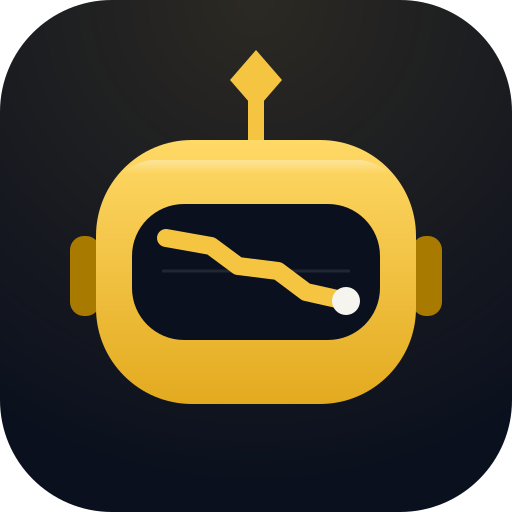
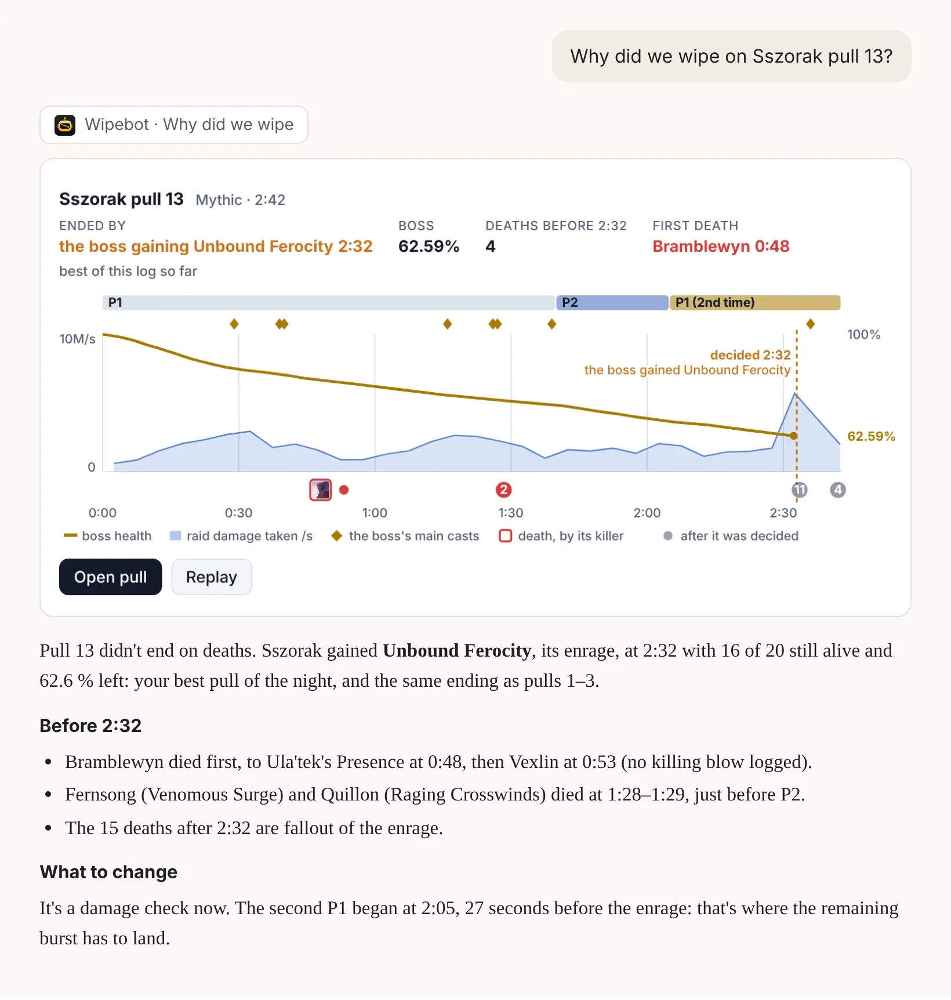
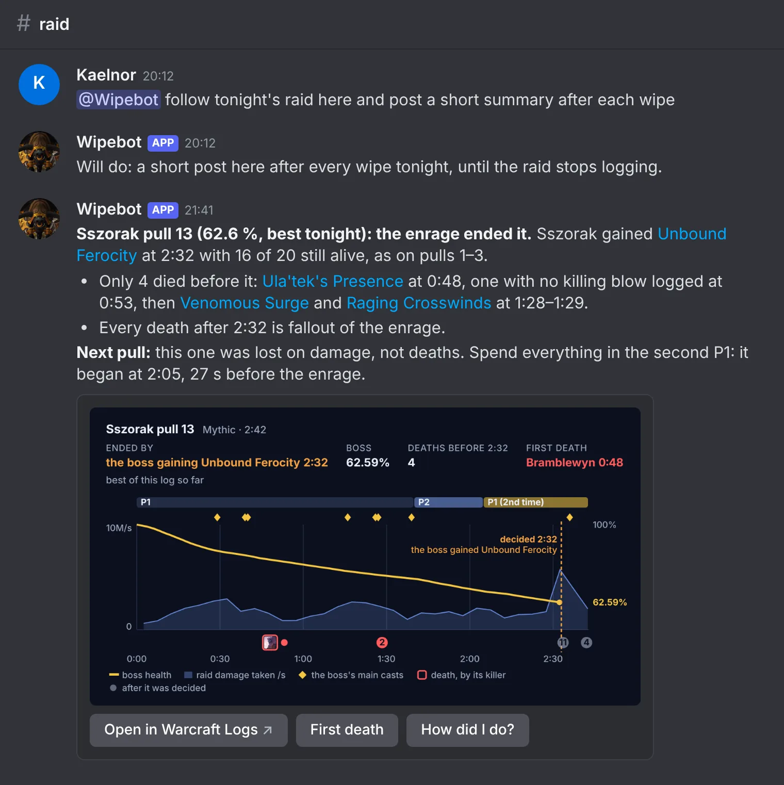

<h1> Wipebot</h1>

An AI raid analyst for World of Warcraft®. It reads [Warcraft Logs](https://www.warcraftlogs.com) reports and answers
questions about them in Claude, ChatGPT or another assistant that takes MCP connectors, or as a Discord bot that
answers in the guild's channels and DMs and posts after each wipe. Use the free public copy, or run your own for your
guild.

## Try it

A public copy runs at [wipebot.enfo.dev](https://wipebot.enfo.dev), free and best effort, for any guild:

- **Claude:** **Add to Claude** on that page, then **Continue** and sign in with Warcraft Logs.
- **ChatGPT and others:** add `https://wipebot.enfo.dev/mcp` as a custom MCP server and sign in with Warcraft Logs.
- **Discord:** **Add to Discord** on that page, then DM or mention the bot. Each server gets a small amount of free
  AI use every month to try it out (`/usage` shows what's left); to keep going, an admin adds an AI key they have
  from OpenRouter or Anthropic with `/wipebot key`, and the server's answers run on it.

Every guild shares the public copy, and Warcraft Logs lets it read only so much each hour: when that's used up,
questions that need new data wait for the next hour. Signed in with Warcraft Logs, your questions use your own
allowance first. For your guild alone, run your own copy ([Setup](#setup)).

## What you can ask

Ask in your own words:

- **Why did we wipe?** What ended the pull (an enrage, a mechanic that killed many, deaths one after another) and the
  first mistake that led there, with the pull drawn under the answer. In Discord, it posts this after every wipe.
- **What killed me?** The seconds before a death, the healing, and whether a defensive you had ready would have saved
  you.
- **How did I do tonight?** Your night on the boss, your cooldowns pull by pull, and your casts, talents and gear
  against the top players of your spec.
- **Who keeps getting hit by Virulence? Who missed their kick?** Per player over the night, and checked against the
  raid note your officers saved.
- **Give us the short version of this boss.** The guides side by side with Blizzard's latest hotfixes, and a spec's
  priorities and cooldowns, before there's a log.

<p>
  <picture>
    <source media="(prefers-color-scheme: dark)" srcset="docs/images/claude-why-did-we-wipe-dark.webp">
    
  </picture>
  <picture>
    <source media="(prefers-color-scheme: dark)" srcset="docs/images/discord-wipe-post-dark.webp">
    
  </picture>
</p>

More, with examples: [docs/features.md](docs/features.md).

## How it works

The analysis is code: tools compute every number in an answer from the log, and the model picks the tools and
explains their output. The tools are an [MCP](https://modelcontextprotocol.io) server, used two ways:

- **Connector**: members add your server to Claude, ChatGPT or similar and sign in with Warcraft Logs; answers run
  on their own subscription.
- **Discord bot**: the guild asks in channels and DMs, and it can post after each wipe; answers run on the host's
  Anthropic or OpenRouter key, or on an AI key a server's admin added (`/wipebot key`).

## Setup

You need a Warcraft Logs API client from [warcraftlogs.com/api/clients](https://www.warcraftlogs.com/api/clients)
(not a public client) and the guild's reports public. The connector and the bot run with Docker Compose.

```sh
git clone https://github.com/Enf0/wipebot.git && cd wipebot
cp .env.example .env
mkdir -p data/wipebot-discord data/wipebot-mcp data/wipebot-notes && sudo chown -R 1000:1000 data
```

### Connector

1. In `.env`, set `WCL_CLIENT_ID` and `WCL_CLIENT_SECRET`, `WIPEBOT_PUBLIC_URL` (e.g. `https://wipebot.example.com`)
   and `WIPEBOT_ALLOWED_GUILDS` (the guild's warcraftlogs.com address). Give the client the redirect URL
   `https://<your host>/wcl/callback`.
2. `docker compose up -d --build wipebot-mcp`, with a reverse proxy serving HTTPS in front of `127.0.0.1:8000`.
3. Members add `https://<your host>/mcp` as a connector and sign in with Warcraft Logs. In Claude, a link fills the
   connector in for them, and a plugin adds the method too ([docs/setup.md](docs/setup.md#the-connector)).

### Discord bot

1. Create an application in the [developer portal](https://discord.com/developers/applications), turn off **Public
   Bot**, and set `DISCORD_TOKEN`, `ANTHROPIC_API_KEY` (or `OPENROUTER_API_KEY`) and the Warcraft Logs client in
   `.env`.
2. `docker compose up -d --build wipebot-discord`, and invite it with the link in its log.
3. Raiders can ask it about any report they link right away, and about the game without one. Run `/wipebot setup`
   with the guild's Warcraft Logs page, and it also finds the guild's latest raid by itself, posts after wipes and
   keeps raid notes. `/help` shows raiders what to ask.

Every setting, the Warcraft Logs quota, raid notes and plans, upgrading and troubleshooting:
[docs/setup.md](docs/setup.md).

## Costs and data

- The connector costs only hosting: members' answers run on their own plan. The bot's answers cost about
  $0.15-0.25 each with Claude Opus ([docs/models.md](docs/models.md)); `/usage` shows what they've cost.
- Everything Wipebot keeps stays in `./data`: who signed in, the characters and preferences raiders give the bot,
  and what each answer cost ([docs/setup.md](docs/setup.md#whats-kept)). Only what an answer needs goes to the
  model.

## Limitations

- Built and tested for retail raids, for now. It may answer about a Mythic+ log's boss fights, but it knows nothing
  of keys yet (the timer, trash, affixes) and its guides and comparisons are for raids. Classic logs are on Warcraft
  Logs' separate Classic sites, which it doesn't read yet.
- The method, how to read a raid log, is a [skill](src/wipebot/core/skills/raid-log-analysis): the bot and Claude
  with the plugin use it. A connector alone gets only the tools, whose output carries what code can decide of the
  method, since assistants don't yet load skills from a server
  ([docs/reference/mcp-clients.md](docs/reference/mcp-clients.md)).
- The Discord bot is built and tested on Claude (Opus by default, Sonnet and Haiku compared in
  [docs/models.md](docs/models.md)). Through OpenRouter, `WIPEBOT_MODEL` can name another model, untested so far.
  The connector works with any assistant that takes MCP connectors.

## Development

[CONTRIBUTING.md](CONTRIBUTING.md): setting up (uv and just), the checks, and how the tests
([tests/README.md](tests/README.md)) and evals ([evals/README.md](evals/README.md)) work. Maintained on a best-effort
basis; for a feature, open an issue before a pull request.

## Contact

Open an issue, or reach the maintainer: Enfo (`enf0`) on [Discord](https://discord.com/users/111820993068081152), or
enfo@enfo.dev. Security problems go privately through **Security → Report a vulnerability**
([CONTRIBUTING.md](CONTRIBUTING.md#security)).

## License

Wipebot is free software under the [GNU Affero General Public License v3.0](LICENSE) or later. You may use, change
and host it; if you run a changed copy for others, as a connector or a bot, you must offer them its source under the
same license.

Wipebot isn't affiliated with or endorsed by Blizzard Entertainment or Warcraft Logs. World of Warcraft and Warcraft
are trademarks or registered trademarks of Blizzard Entertainment, Inc.
