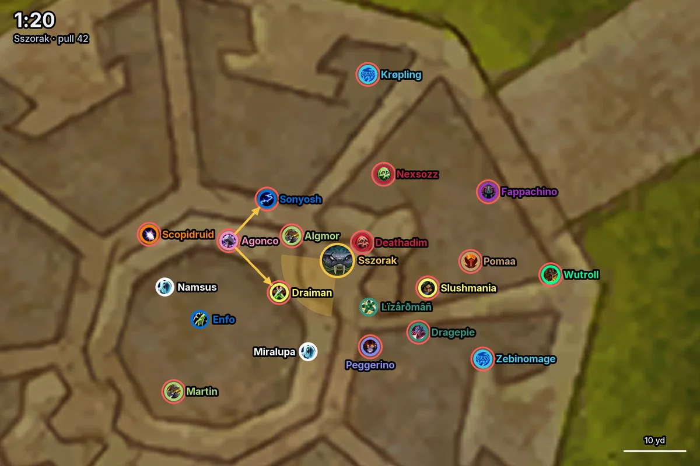
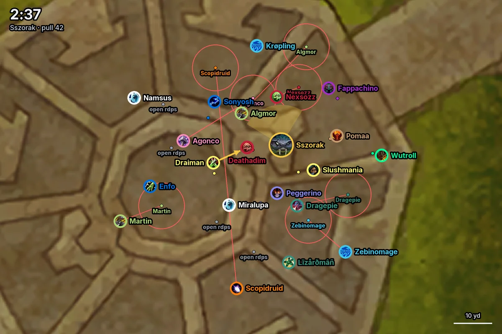
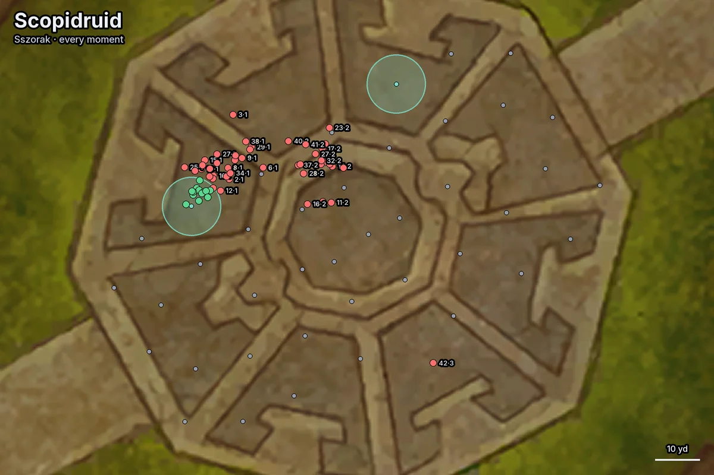

# Features

What Wipebot can answer and how, in more detail than the [README](../README.md). The questions below are examples. You
ask in your own words, and the model picks the tools. Every number in an answer comes from a tool reading the log.

Unless you name a report, Wipebot reads the guild's latest raid night. A question names a pull ("pull 12", "the kill",
"the best wipe"), a boss ("Sszorak"), a time ("at 2:31") or a player, or none of these: then it means the latest
pull.

## A pull: why did we wipe?

- **What ended it.** Every death in order, with spec, the ability that killed them and how many players were still
  alive. Also when half the raid was dead, and whether the boss gained a buff it kept to the end (an enrage). The
  wipe is put down to one ability killing many players at once (or in pulses over a few seconds), a buff on the
  boss, half the raid dead or deaths spread out, starting from the first death that stayed (not one a battle res
  undid). Before a moment that killed many, it names the deaths that led into it, which often left the raid short.
  When no enrage ended it, it says so: deaths lost the pull, not a damage check. Deaths after the wipe was decided
  are marked as fallout and don't count against anyone.
- **How it compares.** Each wipe is compared with the night's earlier pulls and the guild's best on the boss so far,
  and says whether it ended the way earlier pulls that night did, or got past what ended most of them.
- **One death in detail** ("what killed X?", "could they have lived?"): every hit in the 10 seconds before it, with
  health after each hit, the healing they got and what each healer was casting, the defensives they had ready and
  whether a healthstone or potion was used.
- **The timeline** ("what happened at 2:31?", "when did we lust?"): phases, the boss's casts and buffs, the adds' casts
  and whether each was kicked, debuffs on players, deaths, Bloodlust, battle res and raid cooldowns, then the boss's
  health and energy over time.
- **Mechanics** ("who keeps standing in things?", "who got hit by the soak?"): who was hit by an ability or got its
  debuff, and how often, on one pull or on every pull of the night, or only in one stretch of each pull ("the first
  set of orbs"). Asked with no ability, it lists every ability that hurt the raid and who took twice the usual damage
  from it or more. Who was hit isn't whose job it was: the raid note says that.
- **Adds and kicks** ("were the adds killed in time?", "did anyone have a kick ready?"): how many adds came, when they
  died, every cast that was kicked (and by whom) or went through, and who had their interrupt ready when a cast went
  through. Over the night, for the adds that took the most damage, when each wave of them died and each player's
  damage on them.
- **Tanks** ("did the tanks swap?"): who had the boss when, what taunted it, each tank's debuff stacks and tank
  deaths.
- **Healing** ("did the healers keep up?", "were our cooldowns on the peaks?"): the moments of heavy raid damage and
  the abilities behind them, how much of the damage was healed, each healer's healing in those moments, and the
  healing cooldowns used or still ready. Over a night, damage peaks that come back every pull are grouped.
- **Against a kill or another pull** ("do we need more damage?", "what changed since last pull?"): phase timings and
  boss health against a kill by another guild with similar item level, or two of our own pulls side by side.
- **Prep** ("is everyone prepared?"): who had no flask, food, augment rune, vantus rune or weapon oil, and whose
  talents, enchants or gems differ from the top players of their spec on that boss.

## The night: how did tonight go?

- **The night at a glance:** every boss pulled, kills with their speed and execution percentiles, the best wipe, time
  spent, the trend and the guild's progress rank.
- **Every pull on a boss:** boss health, phase, duration and first death of each, averages over the night, how the
  pulls ended counted by what ended each (the one thing that ends most of them stands out), and the night's killer:
  the ability behind the most deaths, who it killed and who it hit most.
- **Week over week** ("are we doing better than last week?"): the boss on each of the guild's raid nights over the
  last weeks: the pulls, the kill, the best wipe and what ended the pulls, night by night.
- **Who pulled?** Who hit the boss first on each pull, and with what.
- **Earlier nights:** other reports of the guild, a raider's pugs and alts, and who has come to raid over the last
  weeks.

## A player: how did I do?

- **One pull:** parse on a kill (on a wipe, how their throughput per second alive compares with the spec's kills),
  rank in their role, active time, damage by target, deaths, casts, major cooldowns used against how many they could
  have used, DoT and buff uptime, resource capping, healthstones, potions and consumables. Time lost is split into
  time dead, gaps in casting and time at the resource cap.
- **One night on a boss:** their best pull, deaths, cooldown use per pull, and whether they're getting better (deaths
  and output in the first, middle and last third of the pulls).
- **Against the top players of their spec** on the same boss and difficulty:
  - build: talents, item level, trinkets, enchants, gems, stats and consumables against the top 50 parses and the
    class guides' builds;
  - casts: casts per minute of each spell against the top five players closest in item level, and the spells they
    cast much less or more often, or never;
  - cooldowns: when they pressed their cooldowns in a phase against when the top players did.

  With no player, the same comparison says what the top players of a spec play on a boss, or what the fastest kills
  brought ("is it a 4-heal fight?").
- **A buff at a cast** ("did I have Starlord stacks when I cast Convoke?"): whether a buff was up, and how many
  stacks, each time they cast a spell.
- **Defensives** ("would a personal have saved me?"): the raid's healthstones, potions and defensives over the night,
  and at how many deaths a defensive was ready but not used.
- **Over the season:** every ranked kill with its percentile from any report, what they keep dying to night after
  night, their Raider.IO progression and Mythic+ score, and the guild's rankings by role.

## Positions and maps: where was everyone standing?

Wipebot draws the boss room's map with every player on it, as a spec icon in their class colour, named, with their
distance to the boss and how far off its facing they stood.

- **A moment:** a time ("at 3:10"), a death ("where was everyone when X died?"), or every time an ability happened
  ("were we spread for the bombs?"). For a debuff it says who was hit by it without having it, and from whom: the
  nearest player who had it.
- **Over the night:** the same counted per player and per pair over every pull on the boss, and a map of one player's
  position every time the ability happened.
- **Where it shows:** in Discord the map is a picture under the answer. In Claude, the connector shows a replay of the
  whole pull instead, which you can play, pause, speed up and scrub through.

*"Who exploded on whom?" on Sszorak pull 42: Virulence ran out on 16 players at 1:20. The arrows show who was hit by
someone else's: Sonyosh and Draiman by Agonco's. The shaded cone is the boss's facing.*

## Raid notes and plans: what's the plan, and did we follow it?

The officers save the raid's note and positioning plan once. Wipebot tells raiders what the plan asks of them, and
checks pulls against both.

### Saving them

Officers save them by pasting the export, in either app; anyone else's paste is used for that answer only.

- **In Claude or ChatGPT:** paste it into the chat and ask to save it for the guild. Officers are the members with a
  character at the guild's Guild Master or Officer rank (or the ranks the host chose), as Warcraft Logs has it.
  ChatGPT asks before saving, as for any tool that changes something.
- **In Discord:** paste it in a message to the bot, in a server connected to the guild's Warcraft Logs page
  (`/wipebot setup`); Discord turns a long paste into a file, and that works too. Officers are the members with the
  role set by `/wipebot setup officers:<role>`, or, with none set, those who can manage the server.
  `/wipebot settings` lists what's saved.

What can be saved:

- **Raid note:** the whole note exported from Viserio (NSRT format), with its `EncounterID` line for each boss. It
  holds the assignments (soak groups, spreads, single-player jobs), timed cooldowns and callouts.
- **Raid plan:** a raidstrats.gg plan's export (`raidstrats-addon-...`), every scene of it: the numbered spots, the
  raid markers, the boss and adds, shapes, arrows, labels and the side panel with its groups and instructions. From
  raidstrats.gg's planner (Export) it's the plan as drawn, its spots numbered. From Viserio's assignment note (the
  RSGG Addon button) it's the same plan with the night's raiders on their numbers.

Raid plans can also be fetched from raidstrats.gg instead of pasted, where the host set it up
([setup.md](setup.md#raid-notes-and-plans)): every plan the officer who connected can open, fetched again when
someone asks, so an edit on raidstrats.gg counts from the next question. A pasted export with the night's raiders
stays the one used until the plan itself changes on raidstrats.gg.

The raid nights to come can be read from Viserio Cooldowns, with the key the group's admin makes there
([setup.md](setup.md#raid-notes-and-plans)): each night in the next eight days with its sign-ups (absent, late,
tentative), and per boss planned in the week's setup who's in, by role, and who's out. So "am I in on Coiled Altar
tomorrow?", "who's benched?" and "who's coming Monday?" are answered before there's a log.

Only a pasted export is saved, not typed text, a screenshot or a link. Every version is kept, with who saved it.
Each pull is checked against the note saved before it started, so changing the note mid-night doesn't affect earlier
pulls. A note counts only for the raid night it was saved for, as officers change it each night with who comes: one
saved before the guild's last night on the boss, or more than 12 hours after a night's log ended, isn't used for that
night (a night with none asks for the paste). A note pasted after the pulls it was for counts from the pull the
officer names: "from pull 7" in the message with the paste in Discord (the night's report, or a report link in the message), or said in the chat in
Claude or ChatGPT. Both apps read what's saved for the guild, wherever it was saved, so no one needs to paste it
again.

### The plan itself

Asked about the plan rather than a pull ("what's our plan for Coiled Altar?", "where do I stand in P3?", "who carries
the purple orbs?"), Wipebot reads the guild's newest plan for the boss and answers from it, with no log needed: before
the raid, or for a boss not pulled yet.

- **Scene by scene:** each numbered spot with its role, and the raider on it when the plan has the night's raiders.
  Where it is, by the boss and the raid markers ("above right of the boss, by the triangle marker"), and which shape
  it's in (the frontal's cone, a soak circle). Then the adds and ability icons with their labels ("Gloom 1"), the
  labels in the room, the shapes and what's in each, and the arrows from where to where.
- **What each number does:** the side panel's groups and instructions with the numbers in them ("Purple Orb
  Carriers: 1-4, prioritise your corner").
- **Your spot first:** asked by a raider, or about one, their spot leads each scene.

Places are as the plan draws them, not measured in the room: the plan has no room coordinates. A plan with several
scenes (one per set of orbs, one per phase) is told in order.

### What gets checked

- **The note** ("did people do their jobs?", "who missed their soak?", "were the cooldowns on time?"):
  - each soak: who in the assigned group wasn't hit (alive or dead), and who else was;
  - each planned cooldown: cast on time, early, late or not at all;
  - each kick assignment (a callout to one player as an add begins its cast): who kicked that cast, or whether it went
    through (a cast another player kicked, such as a tank backing up, was handled: it's counted as covered, not
    missed);
  - each callout ("Big Personals" to everyone, a job for one player): what the players it names pressed around that
    time, and what they had ready.

  Over the whole night, it counts per player: soaks missed while alive, cooldowns on time or not, kicks made,
  covered or let through, how often they answered each callout, and the pulls whose wipe came within seconds of
  casts on kick assignments going through. When the note's kick order only fits the later pulls (a raider joined or
  the order was changed, and the note was pasted afterwards), it says from which pull, what the pulls before had, and
  counts the kicks from that pull on. A note saved only after the pulls it's checked against is said to be so.
- **The plan** ("was everyone on their spot?"): at each moment of the plan's mechanic, who was off their spot and by
  how far, whose spot they stood at instead, who was dead, and who was hit by the debuff from whom. Since the plan has
  no room coordinates, it is fitted to where the raid stood, so a player is off relative to the rest of the raid. A
  map shows the plan's spots over where everyone stood, with lines to those off their spot ("show me the pull
  against the plan"; in Claude, the pull's replay with the plan's spots and a button per moment). Over the night, it
  counts per player how often they were off, and where.

*A spread plan from raidstrats.gg against Sszorak pull 42, at the third Virulence (2:37). Each small dot is a spot on
the plan with its player's name. A red ring marks a player who wasn't on their spot, with a line to where they
stood.*

*One player against their spot over a whole night (42 pulls): green where they were on their spot, red where they
weren't, each labelled with the pull and the moment. The grey dots are the other players' spots. The plan is used
mirrored on some pulls, so their spot appears on both sides.*

Wipebot finds who was hit or who stood where on its own. The note and the plan are what tell it whose job it was.

## The game

- **Bosses:** strategy from Method, Wowhead and Icy Veins side by side, every ability's tooltip, and loot (with a
  spec, which drops its best-in-slot lists name).
- **Classes:** a spec's guide on a topic (rotation, talents, stats, gear) and its cooldowns with their lengths.
- **Spells:** what a spell or boss ability does.
- **Hotfixes:** Blizzard's recent hotfixes about a boss, raid, class or spec, which can explain why a fight changed
  between nights.
- **Anything else:** a search of the guide and news sites, or a full page of one. For the rare log question no tool
  covers, the model can query the Warcraft Logs API directly.

## In Claude and ChatGPT

The connector brings the tools to Claude.ai, ChatGPT or similar, signed in with Warcraft Logs. It knows your
characters from the ones you claimed there, and "my guild" means the guilds they're in. It reads the guild's saved
notes and plans, officers save a pasted one there, and in Claude it shows the pull replay. In Claude, the plugin adds
the skill, so Claude reads logs the same way the bot does. Other clients get only the tools ([reference/mcp-clients.md](reference/mcp-clients.md)).

## In Discord

- **Where to ask:** in a channel, @mention the bot or reply to it. In a DM, every message is a question. With the
  setting on, it also reads the channel's last 15 messages for context.
- **Who it names:** in a server channel it doesn't blame players: it says what went wrong and how to fix it, without
  names. Praise is fine, and so is feedback on the asker's own play. In a DM, and in the channels where an admin turned
  names on with `/wipebot names`, it names players.
- **In your DMs instead:** ask it in a channel to send something to your DMs, and it answers there as if you'd
  asked there, where it may name players. It only ever writes to the one who asked.
- **Posts after each wipe:** ask it to follow tonight's raid, and it posts after every wipe, in a DM (your own
  feedback) or in a channel (what you asked for), until the report ends or you tell it to stop. It works before the
  raid starts logging, too.
- **It remembers** your character, so "how did I do?" needs no name, and preferences you ask it to keep ("answer in
  English"). Ask what it remembers, or tell it to forget.
- **Admin commands:** `/wipebot setup` connects the server to the guild and sets who can chat with the bot,
  `/wipebot names` turns naming players on or off in a channel, and `/wipebot settings` shows the setup and the
  saved notes and plans. Officers (a role `/wipebot setup` sets) save a note or plan by pasting it to the bot, and
  change or stop anyone's posts after wipes in a channel. Who can do what:
  [setup.md](setup.md#officers-and-admins).
